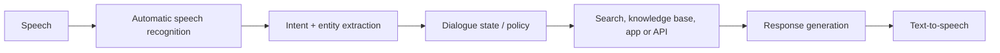
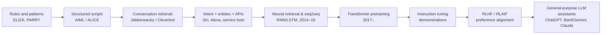
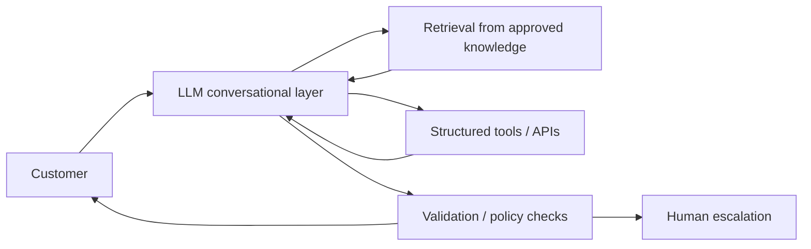

> **Provenance.** A ChatGPT deep-research report Marlon ran on 2026-10-19, brought in verbatim below this note. It is a secondary synthesis, not a checked source. The `citeturn…` markers (about 150 of them) are ChatGPT's internal citation tokens and can't be followed from here; only the 22 links in "Further reading" are real URLs. Before a claim from this report goes on a page, check it against task J's ledger (`nextjs/content/history/fact-check.md`), the glossary's sources, or the primary source, and mark it "(verify)" otherwise. Useful for: the periodization (five regimes, and the "inversion" from manufacturing dialogue to constraining it), PARRY, AIML and Jabberwacky, the assistant and customer-service era, the dialogue datasets, and the law and ethics section, all of which the story (task M) and glossary cover thinly.

# A History of the Chatbot: From Pattern Matching to Large Language Models

## Executive summary

The history of the chatbot is often narrated as a steady progression from primitive scripts to increasingly intelligent machines. That account is too simple. The more revealing history is a succession of **different theories of what conversation with a computer is for**: first a test of machine intelligence; then a theatrical simulation of understanding; then a way to model psychological states; then an entertainment medium; then an interface to search, commerce, customer service, and devices; and, finally, a general-purpose interface to large pretrained models.

Five technical regimes organize that history.

**First, symbolic conversation.** Alan Turing's 1950 imitation game reframed the philosophical question "Can machines think?" as an observable conversational test. The canonical early chatbot, Joseph Weizenbaum's ELIZA at MIT in the mid-1960s, did not model language in anything like the contemporary sense: it identified keywords, applied decomposition patterns, transformed fragments of the user's text, and assembled scripted replies. Yet users attributed striking degrees of understanding to it—an early warning that conversational form itself produces anthropomorphic effects. Kenneth Colby's PARRY, developed around 1971–72 at Stanford, complicated this architecture by introducing internal state intended to model paranoid cognition. citeturn0search0turn0search1turn0search6

**Second, authored knowledge and conversational memory.** Systems such as ALICE, begun by Richard Wallace in 1995, vastly expanded scripted pattern-response systems through AIML, an XML vocabulary for reusable conversational rules. Jabberwacky and its descendant Cleverbot took a different route: rather than relying principally on authored responses, Rollo Carpenter's systems accumulated human conversations and reused them contextually. The chatbot was beginning to move from *rules written by programmers* toward *behavior derived from data*. citeturn1search5turn24search4

**Third, the assistant and platform era.** SmarterChild on AIM in 2001 combined social chat with information services. Siri's 2011 integration into the iPhone, followed by Cortana in 2014, Alexa in 2014, and Google Assistant in 2016, transformed conversational computing into an operating-system and device interface. These systems typically combined automatic speech recognition, natural-language intent and entity detection, dialogue state management, APIs or knowledge services, and speech synthesis. Meanwhile, Facebook Messenger, Microsoft's Bot Framework, IBM Watson, Salesforce, and others commercialized similar architectures for customer service. citeturn3search3turn2search1turn2search6turn4search8turn16search0

**Fourth, neural conversation.** Sequence-to-sequence models in 2014–15 showed that responses could be learned end-to-end rather than manually authored. Retrieval models learned which stored response to choose; generative models learned which token to produce next. The 2017 Transformer removed recurrence in favor of attention, making much larger-scale language modeling practical. Dialogue corpora such as Ubuntu Dialogue Corpus, DailyDialog, PERSONA-CHAT, and MultiWOZ became important experimental infrastructure. citeturn5search0turn5search1turn5search2turn17search1turn17search10

**Fifth, foundation-model chat.** GPT-style generative pretraining demonstrated that a single Transformer could acquire broad linguistic capabilities from large unlabeled corpora; GPT-3 showed strong zero- and few-shot behavior at scale. Instruction tuning and reinforcement learning from human feedback, especially the InstructGPT work, supplied the missing interface layer: models were trained not merely to predict text but to respond to instructions in ways humans preferred. ChatGPT productized this synthesis in November 2022. Google's LaMDA pursued dialogue-specific large-scale pretraining and safety/grounding fine-tuning; Bard initially exposed LaMDA as a consumer service before moving to PaLM 2 and then becoming Gemini. Anthropic's Claude combined Transformer language modeling, RLHF, and Constitutional AI/RLAIF. citeturn18search9turn19search1turn7search3turn6search1turn8search0turn10search1turn11search0

The most important historical discontinuity is therefore not simply that modern chatbots are "better." **Older chatbots were principally conversational systems with knowledge attached; contemporary LLM assistants are principally knowledge-bearing generative models to which conversation has become the dominant interface.** The earlier problem was how to manufacture enough plausible dialogue. The contemporary problem is almost the inverse: how to constrain an extraordinarily productive model so that its dialogue remains factual, safe, private, attributable, and aligned with human purposes.

That inversion explains the evolution of the ethical debate. ELIZA raised questions about anthropomorphism; customer-service bots raised questions about disclosure and surveillance; social bots such as Tay exposed adversarial manipulation and bias; LLM systems add hallucination, training-data governance, large-scale persuasion, synthetic media, voice cloning, and deepfakes. Regulation has consequently begun to move from regulating particular uses of bots toward regulating transparency and governance across the generative-AI stack. California's bot-disclosure law became operative in 2019; as of October 2026, Article 50 of the EU AI Act requires, among other things, disclosure when people directly interact with qualifying AI systems and establishes transparency requirements for AI-generated content and deepfakes. citeturn20search0turn22search3turn21search5

## Origins: imitation, rules, and the first conversational programs

### Turing's crucial move: from intelligence to performance

Alan Turing's 1950 paper, *Computing Machinery and Intelligence*, is the conceptual starting point even though it describes no chatbot. Rather than attempt to define "thinking," Turing proposed the **imitation game**, in which a human interrogator communicates by text and attempts to distinguish a machine from a person. He predicted that roughly fifty years later computers might perform well enough that an average interrogator would have no more than a 70 percent chance of making the correct identification after five minutes. This was not a technical specification for conversation; it was an epistemological wager that intelligence might be judged behaviorally through language. citeturn0search0

That distinction matters historically. There is no canonical "1950s chatbot" comparable to ELIZA. The 1950s supplied the evaluative imaginary; the mid-1960s supplied the canonical conversational implementation.

Turing's framework also established an ambiguity that has accompanied chatbots ever since. A system can be evaluated according to at least three very different criteria:

1. whether it produces human-like conversational behavior;
2. whether it successfully accomplishes a user's task;
3. whether it possesses robust models, knowledge, or reasoning underlying that behavior.

Those criteria overlap, but they are not identical. Much of chatbot history consists of mistaking success at one for success at another.

### ELIZA: conversation as transformation

Joseph Weizenbaum developed ELIZA at MIT in 1964–66 and described it in a January 1966 *Communications of the ACM* paper. ELIZA was not a single personality so much as an interpreter plus replaceable scripts. The famous DOCTOR script imitated a nondirective psychotherapist because that conversational role made questions, paraphrases, and requests for elaboration seem natural even when generated mechanically. citeturn0search1turn0search5

Its basic machinery was elegantly small:

- identify keywords and rank them by priority;
- find a decomposition pattern matching the input;
- transform captured phrases, including pronoun changes such as first to second person;
- insert those phrases into a reassembly template;
- maintain a small amount of context or use generic fallbacks when no useful rule matches. citeturn0search1

An **illustrative** ELIZA-like algorithm—not Weizenbaum's original source code—looks like this:

```text
function respond(input):
    normalized = normalize(input)

    for keyword in keywordsByPriority(normalized):
        for rule in rules[keyword]:
            match = matchPattern(rule.decomposition, normalized)

            if match:
                fragments = transformPronouns(match.fragments)
                return choose(rule.reassemblies)
                       .substitute(fragments)

    return choose(genericFallbacks)
```

The paradigm can be summarized as:

\[
\text{utterance}
\rightarrow
\text{pattern match}
\rightarrow
\text{text transformation}
\rightarrow
\text{scripted response}.
\]

There is no learned semantic representation in this loop. Nevertheless, Weizenbaum reported being surprised by how readily users treated the program as an understanding interlocutor. That gap—between the mechanism's thinness and the experience's apparent depth—became one of the foundational cultural facts of conversational computing. citeturn0search1

### PARRY: adding a model behind the utterance

Psychiatrist Kenneth Colby and collaborators at Stanford developed PARRY around 1971–72 as a computational model of paranoid thought. Whereas ELIZA's visible behavior was governed primarily by transformations over the user's language, PARRY coupled rules to internal variables intended to represent aspects of belief, fear, anger, mistrust, and conversational strategy. Its objective was therefore not merely to imitate surface dialogue but to use dialogue as evidence of an underlying psychological model. citeturn0search6turn0search2

In simplified form:

```text
state = {
    mistrust: 0.7,
    fear: 0.5,
    anger: 0.2
}

function respond(utterance, state):
    interpretation = applySemanticRules(utterance)
    state = updateAffectiveState(state, interpretation)

    intention = chooseResponseStrategy(state, interpretation)
    return realizeWithRules(intention)
```

Experimental studies in 1972 asked psychiatrists to distinguish transcripts involving PARRY from those involving patients; the results showed how difficult such transcript-based judgments could be, although they should not be retroactively interpreted as demonstrating general intelligence. citeturn0search2turn0search10

The difference between ELIZA and PARRY foreshadows a distinction that survives today: **Is a chatbot merely choosing the next plausible utterance, or does it maintain a consequential internal representation of the conversation?**

### From "chatterbot" to AIML

Michael Mauldin's 1994 AAAI paper on Julia and TinyMUD systems used the term **"ChatterBot"**, an important naming milestone for the emerging category. Julia combined hand-authored patterns, variables, state, and randomized responses while operating in a social multi-user environment. citeturn1search0

Richard Wallace's **A.L.I.C.E.**, begun in 1995, systematized the scripted approach using **AIML—Artificial Intelligence Markup Language**. AIML represents conversational knowledge as categories containing a user-input pattern and a response template, with additional mechanisms for context and topic. Wallace reports that ALICE eventually contained tens of thousands of such categories and won the Loebner Prize in 2000, 2001, and 2004. citeturn1search5

A generic AIML category illustrates the design:

```xml
<category>
  <pattern>I FEEL *</pattern>
  <template>
    What makes you feel <star/>?
  </template>
</category>
```

AIML made the rule base more maintainable and shareable, but it did not remove its basic limitation: someone—or a community—still had to anticipate conversational forms and associate them with suitable outputs.

### Jabberwacky: conversation becomes the database

Rollo Carpenter's Jabberwacky/Cleverbot lineage represented a different idea: learn conversational material from actual users and choose responses contextually from accumulated interactions. Cleverbot's official account dates the underlying project to **1988** and describes responses as being selected by comparing the current conversation with large numbers of previous conversations. Public sources disagree about how to date the Jabberwacky/Cleverbot product lineage precisely; 1988 is best treated as the beginning of Carpenter's learning-AI work, while Jabberwacky is commonly dated to public web availability around 1997 and Cleverbot.com to 2006. Where a single "launch date" is asserted for the whole lineage, it is therefore **not fully specified by a consistent primary historical record**. citeturn24search4turn24search3

The retrieval paradigm is conceptually different from AIML:

```text
function respond(history, userInput):
    query = representation(history + userInput)

    similarContexts =
        conversationIndex.nearestNeighbors(query)

    candidateReplies =
        repliesThatFollowed(similarContexts)

    return rank(candidateReplies, contextFit).first()
```

Cleverbot's own description emphasizes the key fact: what one user says can influence what the system later says to someone else. By 2011 it was being tested in public Turing-test-style demonstrations. citeturn24search0turn24search4

The shift is conceptually significant:

> **ELIZA:** programmers write the conversational knowledge.  
> **AIML:** programmers formalize and scale the conversational knowledge.  
> **Jabberwacky:** users themselves become a source of the conversational knowledge.

That transition—from authored rules to accumulated interaction data—anticipates a central principle of machine learning, even though the mechanisms were radically simpler than modern neural networks.

## From social chat to assistants, platforms, and customer service

### SmarterChild and the instant-messaging generation

ActiveBuddy, founded in 2000 by Timothy Kay, Robert Hoffer, and Peter Levitan, launched **SmarterChild** on AOL Instant Messenger in 2001 and later on other messaging systems. Unlike purely social chatbots, SmarterChild combined a conversational persona with practical retrieval: users could ask for information such as weather, sports, and other services from inside a chat window. At its height it reportedly served millions of users, and ActiveBuddy subsequently built branded and customer-service agents; the company became Colloquis and was acquired by Microsoft in 2006. citeturn3search3

SmarterChild is commercially important because it demonstrated a proposition that would recur in Siri, Alexa, messaging bots, and ChatGPT: **conversation can be an application shell**. Instead of navigating menus, URLs, and forms, a user can describe an intention linguistically.

### Siri: the assistant moves into the operating system

Siri emerged from research at **SRI International**, including work connected to the DARPA-funded CALO project. SRI spun off Siri, Inc. in 2007; Apple acquired the company in April 2010 and introduced Siri as an integrated feature of the iPhone 4S in October 2011. citeturn2search1turn2search5turn2search0

Unlike ELIZA, Siri's central purpose was not open-ended verbal simulation. It was **task completion**. The architecture of this class of assistant typically looks more like a transaction pipeline:



The assistant therefore mediates between natural language and structured services. Asking "Will I need an umbrella after dinner?" is ultimately transformed into something closer to:

```json
{
  "intent": "weather_forecast",
  "location": "current_location",
  "time": "this evening",
  "attribute": "precipitation"
}
```

The essential technical breakthrough was not that Siri could discuss anything; it was that it could map variable language onto useful actions while exploiting speech recognition, contextual information, and connected services. SRI and Apple explicitly positioned it in this personal-assistant tradition. citeturn2search1turn2search0

### Cortana, Alexa, and Google Assistant

Microsoft unveiled **Cortana** with Windows Phone 8.1 in April 2014. It combined Bing-backed information services with a "Notebook" concept intended to store knowledge about the user and support more personalized assistance. citeturn2search6

Amazon introduced **Alexa and Echo in November 2014**. Alexa's architecture made the engineering constraints of domestic voice interaction especially visible: local wake-word detection, far-field microphones, cloud automatic speech recognition, natural-language understanding, and connections to skills and services. Amazon subsequently opened the Alexa Skills ecosystem to third-party developers. citeturn4search2turn4search5turn4search8

Google announced **Google Assistant at I/O in May 2016**, describing it as an ongoing two-way conversation capable of operating across devices and contexts. It appeared in Allo and then in Pixel and Google Home later that year. Google explicitly situated the product at the intersection of search, speech recognition, natural-language processing, machine learning, and task completion. citeturn16search0turn16search4

These assistants changed the cultural location of the chatbot. Conversation was no longer confined to an experimental terminal or website: it became embedded in the **phone, operating system, car, kitchen, speaker, and home**.

### The customer-service bot boom

Around 2016, conversation also became a commercial platform strategy. Facebook opened the **Messenger Platform** to bots in April 2016, envisioning automated interactions for notifications, commerce, information, and customer service. Microsoft simultaneously advanced its "Conversations as a Platform" strategy and released the Microsoft Bot Framework for deploying bots across SMS, Skype, Slack, the web, and other channels. citeturn3search2turn20search7

IBM Watson Assistant and comparable enterprise systems formalized the now-familiar architecture of:

\[
\text{utterance}
\rightarrow
\text{intent}
+
\text{entities}
+
\text{dialogue state}
\rightarrow
\text{business logic}
\rightarrow
\text{response}.
\]

An insurance bot might classify *"I need to change my mailing address"* as `change_address`, extract an account identifier, request missing slots, authenticate the user, call a back-end API, and either complete the transaction or transfer the conversation to an employee. IBM's dialogue tooling, Google's Dialogflow, Microsoft's LUIS/Bot Framework ecosystem, and Salesforce Einstein Bots all exemplified this general pattern. citeturn12search1turn12search2turn12search3

The optimization criterion had changed. A consumer-service bot did not need to "pass" for human; indeed, disclosure could be desirable or legally required. Its commercial metrics were more likely to be **intent-recognition accuracy, containment rate, completion rate, handling time, conversion, and successful handoff**.

The 2016 boom also demonstrated a recurring cycle in chatbot history: an interface can become commercially fashionable before its underlying intelligence is sufficiently flexible. Rule-heavy intent systems worked well in constrained domains but proved brittle when users departed from their modeled intents, supplied ambiguous information, switched topics, or expected genuinely open-ended conversation.

### Tay and the social vulnerability of learned chat

Microsoft's **Tay**, launched on Twitter in March 2016, became a defining counter-milestone. Microsoft intended the entertainment chatbot to learn from interaction with 18-to-24-year-old users; within its first day, coordinated users exploited vulnerabilities and provoked offensive outputs. Microsoft took Tay offline and publicly acknowledged that it had underestimated adversarial misuse. citeturn20search0

Tay demonstrated something that has become increasingly important: a chatbot is not simply a technical model exposed to society; **deployment creates a feedback system between the model, its users, the platform, and adversaries**. Learning from people can make a conversational system adaptive; the same openness makes manipulation itself a training signal.

## The neural turn: retrieval, sequence models, Transformers, and data

### Retrieval versus generation

Before large language models, machine-learning dialogue research divided broadly into **retrieval-based** and **generative** systems.

A retrieval model does not invent arbitrary replies. It scores candidate responses:

\[
r^*=\arg\max_{r\in R} s(c,r)
\]

where \(c\) is the conversational context, \(R\) is a set of candidate responses, and \(s\) is a learned relevance function.

Illustrative pseudocode:

```text
contextVector = encoder(conversationHistory)

for reply in candidateReplies:
    score[reply] =
        similarity(contextVector, encoder(reply))

return argmax(score)
```

The **Ubuntu Dialogue Corpus**, introduced by Ryan Lowe and colleagues in 2015, was particularly influential for this style of research. Constructed from Ubuntu IRC technical-support conversations, its original release contained roughly one million two-person dialogues, more than seven million utterances, and around one hundred million words, enabling large-scale next-response-selection experiments. citeturn5search3turn5search7

Retrieval has a useful property that remains relevant today: because outputs come from a bounded corpus, it can be easier to control factuality and style. Its limitation is equally clear: the correct answer may simply not exist among the candidates.

### Sequence-to-sequence conversation

The 2014 sequence-to-sequence work of Ilya Sutskever, Oriol Vinyals, and Quoc Le showed how one recurrent neural network could encode an input sequence and another could decode an output sequence. Vinyals and Le's 2015 *A Neural Conversational Model* then applied this architecture directly to dialogue, training models to predict a response from previous conversational text using large datasets including IT-support conversations and movie subtitles. citeturn5search0turn5search1

The conceptual change was enormous:

```text
# Rule system
response = authorWrittenRule(userText)

# Retrieval system
response = bestExistingResponse(userText, database)

# Seq2seq system
state = EncoderRNN(userTokens)
response = DecoderRNN.generate(state)
```

Now responses could be **generated token by token** rather than selected from templates or a database:

\[
P(y_1,\ldots,y_T\mid x)
=
\prod_{t=1}^{T}
P(y_t \mid y_{<t},x).
\]

But early neural conversation models often produced generic answers, lost consistency over long exchanges, invented information, and struggled to maintain stable identities. Vinyals and Le explicitly identified consistency as a problem. citeturn5search1

### Dialogue datasets as infrastructure

The neural era made datasets as important as rule books had once been.

| Dataset / corpus | Date | Character | Historical importance |
|---|---:|---|---|
| Movie/subtitle corpora | pre-2015 | Large amounts of quasi-conversational text extracted from films/subtitles | Enabled relatively cheap training of early generative dialogue models; Vinyals & Le used a large movie-subtitle corpus. citeturn5search1 |
| Cornell Movie-Dialogs Corpus | 2011 | 304,713 utterances from 617 films | Widely reusable corpus for research on fictional dialogue and conversational structure. citeturn17search0 |
| Ubuntu Dialogue Corpus | 2015 | ~1M technical-support dialogues | Made large-scale retrieval and response-selection evaluation practical. citeturn5search3 |
| DailyDialog | 2017 | Human-written everyday multi-turn dialogues labeled for communicative intention and emotion | Cleaner alternative to noisy social-media/subtitle conversation. citeturn17search3 |
| PERSONA-CHAT | 2018 | Crowdworker conversations conditioned on assigned personas; 160k+ utterances in the published corpus | Targeted consistency, personality, and engaging social dialogue. citeturn17search1turn17search5 |
| MultiWOZ | 2018 | ~10,000 annotated multi-domain task-oriented dialogues | Became a major benchmark for dialogue state tracking, dialogue acts, and task-oriented generation. citeturn17search10 |

These datasets encoded research assumptions. Ubuntu treated conversation as response selection; PERSONA-CHAT treated it as persistent identity; MultiWOZ treated it as stateful task completion. A dataset is therefore never merely "more language": it operationalizes a theory of successful conversation.

### The Transformer

The decisive architectural break came with Ashish Vaswani and colleagues' 2017 paper **"Attention Is All You Need."** The Transformer replaced recurrent sequence processing with attention mechanisms, allowing tokens to condition directly on other tokens and making training substantially more parallelizable. citeturn5search2turn5search6

The central operation is scaled dot-product attention:

\[
\operatorname{Attention}(Q,K,V)
=
\operatorname{softmax}
\left(
\frac{QK^{T}}{\sqrt{d_k}}
\right)V.
\]

In simplified pseudocode:

```text
Q = X @ Wq
K = X @ Wk
V = X @ Wv

weights = softmax(Q @ transpose(K) / sqrt(d_k))
context = weights @ V
```

This looks deceptively modest. Historically, however, it changed the feasible scale of language modeling. Because Transformer training parallelizes much better than sequential recurrent networks, increasing model size, data, and compute became a viable research strategy.

The resulting lineage can be compressed as follows:



## Foundation models and the modern LLM chatbot

### GPT: pretraining turns language modeling into a general method

OpenAI's 2018 paper **"Improving Language Understanding by Generative Pre-Training"**, by Alec Radford, Karthik Narasimhan, Tim Salimans, and Ilya Sutskever, combined a Transformer language model with generative pretraining on **BooksCorpus**, a collection of more than 7,000 unpublished books, followed by supervised task-specific fine-tuning. The key idea was that one general model could first learn statistical structure from large amounts of unlabeled language and only later be adapted to specific tasks. citeturn18search0turn18search9

**GPT-2**, released in 2019, scaled the approach to 1.5 billion parameters and trained on roughly 40 GB of Internet text derived from about eight million webpages. OpenAI initially staged the model's release because of concerns about synthetic-text misuse—an early indication that language-model capability was becoming inseparable from deployment governance. citeturn19search0

**GPT-3**, described in 2020, scaled to 175 billion parameters and showed that many tasks could be induced simply by placing instructions or demonstrations in the input context, without gradient-based fine-tuning for each task. This was crucial for chat: natural-language prompting itself began to function as a programming interface. citeturn19search1

The pretraining objective is conceptually simple:

```text
for document in massiveTextCorpus:
    for position t in document:
        context = tokens[0:t]
        target  = tokens[t]

        loss += -log(
            model.probability(target | context)
        )

    updateWeights(loss)
```

One objective—predict the next token—could yield translation, summarization, question answering, stylistic imitation, coding behaviors, and dialogue because examples or latent regularities of those activities existed in the training distribution. citeturn19search0turn19search1

But next-token prediction alone does not guarantee that a model will behave as a cooperative assistant. A web-scale model has learned from prose, fiction, arguments, code, misinformation, instructions, dialogues, and countless other genres. It has no intrinsic reason to infer that a user's prompt is an instruction it ought to helpfully follow.

### Instruction tuning and RLHF

The 2022 **InstructGPT** work addressed this gap by combining supervised demonstrations with **reinforcement learning from human feedback (RLHF)**. Human contractors first wrote examples of desirable answers; the model was fine-tuned on those demonstrations. Humans then ranked alternative model responses; those rankings trained a reward model. Finally, reinforcement learning—specifically PPO in the published work—optimized the language model against that learned reward while constraining excessive divergence from the supervised model. citeturn7search3

A simplified pipeline:

```text
# 1. Start with pretrained language model
base = pretrain(nextTokenPrediction, webAndBookText)

# 2. Supervised instruction tuning
sft = finetune(base, humanWrittenPromptResponsePairs)

# 3. Learn human preferences
outputs = generateSeveralResponses(sft, prompts)
rankings = humans.rank(outputs)
rewardModel = trainPreferenceModel(rankings)

# 4. Reinforcement learning
policy = PPO(
    initialPolicy = sft,
    reward = rewardModel,
    regularizer = KL(policy, sft)
)
```

The crucial conceptual shift is:

\[
\text{predict human text}
\quad\longrightarrow\quad
\text{produce text humans prefer as an answer}.
\]

Those are not the same objective.

### ChatGPT

OpenAI released **ChatGPT on November 30, 2022**. Its initial training methodology closely followed the InstructGPT recipe: human trainers produced conversational demonstrations, alternative model responses were ranked, and reinforcement learning was used to improve the resulting dialogue behavior. The initial model belonged to the GPT-3.5 lineage. OpenAI simultaneously warned that the system could generate plausible but incorrect answers and exhibit biased or unsafe behavior. citeturn6search1

ChatGPT mattered historically less because dialogue generation was new—it emphatically was not—than because several previously separate strands suddenly converged:

\[
\text{Transformer scale}
+
\text{generative pretraining}
+
\text{instruction following}
+
\text{preference optimization}
+
\text{chat interface}.
\]

That combination made a single interface useful across writing, programming, tutoring, translation, brainstorming, analysis, explanation, and many other tasks without a developer defining an explicit intent schema for each one.

OpenAI subsequently released **GPT-4 in March 2023**, adding image-input capabilities alongside text and reporting improved performance while retaining limitations including hallucinations and social biases. **GPT-4o**, announced in May 2024, pushed the assistant architecture toward native multimodality across text, vision, and audio, collapsing functions that older assistants handled as separate speech-recognition, language, and speech-synthesis components into a more integrated model. citeturn25search0turn25search1

This is an important historical reversal. Alexa-era architectures often looked like:

\[
\text{audio}
\to
\text{ASR}
\to
\text{NLU}
\to
\text{dialogue policy}
\to
\text{NLG}
\to
\text{TTS},
\]

whereas multimodal foundation-model assistants increasingly learn relationships among modalities inside a common or tightly integrated learned system. citeturn4search8turn25search1

### LaMDA and Bard

Google announced **LaMDA—Language Model for Dialogue Applications—in 2021**. It was Transformer-based but explicitly optimized for open-domain conversation. Google's later technical paper described a family reaching 137 billion parameters, pretrained on approximately **1.56 trillion words** from public dialogue data and other web text. Fine-tuning targeted qualities including sensibleness, specificity, interestingness, safety, and groundedness; the work also experimented with external information-retrieval, translation, and calculation tools. citeturn10search0turn8search0

The distinction between **model** and **product** is important here. **LaMDA** was a language-model research family. **Bard**, announced in February 2023 and opened more broadly in March, was Google's consumer conversational product; it initially used a lightweight LaMDA model. Google moved Bard to **PaLM 2** in May 2023 and renamed Bard **Gemini** in February 2024. Thus "Bard architecture" is not one stable architecture: the product's underlying model changed. citeturn10search1turn10search2turn10search6turn10search3

LaMDA also became a cultural landmark before Bard's release. In 2022 Google engineer Blake Lemoine publicly argued that LaMDA was sentient; Google rejected the claim as unfounded, and the episode drew renewed attention to how linguistic fluency encourages users—even technically sophisticated ones—to infer consciousness or personhood from conversational performance. citeturn24search1

In that respect, LaMDA returned the field to a problem Weizenbaum had already encountered with ELIZA: **as the simulation becomes richer, the human propensity to supply the missing interiority may become stronger, not weaker.**

### Claude and Constitutional AI

Anthropic introduced **Claude in March 2023** as a general-purpose conversational assistant. Anthropic's published model documentation describes the Claude family as Transformer-based and trained with combinations of unsupervised language-model learning, RLHF, and **Constitutional AI**. Anthropic does not publicly specify every model's complete architecture, parameter count, or full training corpus; those details should therefore be treated as **undisclosed rather than inferred**. citeturn8search1turn11search1

Constitutional AI modifies the alignment pipeline. In Anthropic's formulation, a model critiques and revises outputs according to a written collection of principles; AI-generated preference signals can then replace some of the human preference labeling used in conventional RLHF, producing **reinforcement learning from AI feedback (RLAIF)**. citeturn11search0turn11search2

Conceptually:

```text
draft = model(prompt)

critique = model(
    principles +
    "Identify ways this response violates the principles:" +
    draft
)

revision = model(
    principles +
    critique +
    "Write a better response:"
)

preferenceModel.learn(
    AI_or_human_comparison(draft, revision)
)
```

The deeper shift is governance-oriented. RLHF asks, in effect, *What responses do human evaluators prefer?* Constitutional AI adds another question: *According to which explicit principles should preference be constructed?* This does not eliminate normative judgment; it relocates part of it from individual comparison labels into the design and interpretation of a written constitution. citeturn11search0turn11search2

### Major data regimes

Across these generations, "the chatbot dataset" has expanded from dozens or thousands of explicit rules to corpora of unprecedented breadth:

| Era | Representative data | What the data teaches |
|---|---|---|
| ELIZA | Hand-authored patterns and templates | How to transform recognizable utterances into plausible replies. citeturn0search1 |
| ALICE | AIML categories | Large scripted mappings between conversational forms and responses. citeturn1search5 |
| Jabberwacky/Cleverbot | Accumulated human conversations | Which human replies have followed similar conversational contexts. citeturn24search4 |
| Neural dialogue | Ubuntu, subtitles, DailyDialog, PERSONA-CHAT, MultiWOZ | Response selection, generation, persona consistency, dialogue state, task completion. citeturn5search3turn17search3turn17search1turn17search10 |
| GPT-1 | BooksCorpus | Long-range language regularities useful for transfer learning. citeturn18search0 |
| GPT-2 | WebText-style corpus: ~8M webpages / ~40 GB | Broad web language and zero-shot transfer behavior. citeturn19search0 |
| GPT-3 | Large mixed web/book/reference corpora | In-context, zero-shot, one-shot, and few-shot capabilities at scale. citeturn19search1 |
| InstructGPT / early ChatGPT | Prompt-response demonstrations and human rankings layered over pretrained models | Instruction following and behavioral preference. citeturn7search3turn6search1 |
| LaMDA | 1.56T words of public dialogue/web text plus annotated fine-tuning data | Open-domain conversation, safety, quality and grounding. citeturn8search0 |
| Claude | Public internet, licensed/third-party, human/crowdworker and other data categories disclosed at a high level; exact mixture varies and is not fully public | General language capabilities plus helpful/harmless behavioral tuning. citeturn11search1 |

The historical unit of conversational intelligence has consequently changed from **the rule**, to **the stored exchange**, to **the labeled dialogue**, to **the pretrained model parameter**, and finally to **the model plus an alignment and tool-use stack**.

## Timeline and comparison of representative systems

### Timeline of major milestones

| Date | Milestone | Technical / cultural significance |
|---|---|---|
| **1950** | Alan Turing publishes *Computing Machinery and Intelligence* | Introduces the imitation game as an operational conversational criterion for machine intelligence. citeturn0search0 |
| **1964–66** | Joseph Weizenbaum develops and publishes ELIZA at MIT | Keyword-driven decomposition/reassembly establishes the canonical pattern-matching chatbot. citeturn0search1turn0search5 |
| **1971–72** | Kenneth Colby's PARRY | Introduces an internal state model intended to simulate paranoid cognition; evaluated through transcript comparisons with human patients. citeturn0search6turn0search2 |
| **Late 1980s** | Rollo Carpenter begins project that leads to Jabberwacky | Early move toward conversation learned/retrieved from accumulated user interactions; exact product chronology is inconsistently documented. citeturn24search4 |
| **1994** | Michael Mauldin publishes *ChatterBots, TinyMUDs, and the Turing Test* | "ChatterBot" becomes an important label for conversational agents; Julia demonstrates social-environment bot design. citeturn1search0 |
| **1995** | Richard Wallace begins ALICE | AIML scales the authored pattern/template paradigm into a reusable markup system. citeturn1search5 |
| **c. 1997** | Jabberwacky becomes publicly accessible on the web | Large-scale user interaction increasingly becomes the conversational knowledge source; exact dating is not uniformly specified. citeturn24search3turn24search4 |
| **2001** | SmarterChild on AIM | Merges social conversation with live information services and commercial messaging. citeturn3search3 |
| **2007** | Siri, Inc. spun out of SRI | Commercializes work connected to SRI/DARPA CALO research. citeturn2search1 |
| **2010** | Apple acquires Siri | Positions conversational assistance as a mobile-platform capability. citeturn2search1 |
| **2011** | Siri ships with iPhone 4S | Conversational agents become a mass-market smartphone interface. citeturn2search0 |
| **2014** | Microsoft introduces Cortana | Personal assistant integrated with Windows/Bing and user context. citeturn2search6 |
| **2014** | Amazon introduces Echo/Alexa | Far-field voice assistant moves conversation into the home and later supports a third-party skills ecosystem. citeturn4search2turn4search8 |
| **2014** | Sequence-to-sequence learning | Encoder-decoder neural networks establish a general end-to-end sequence-transduction architecture. citeturn5search0 |
| **2015** | *A Neural Conversational Model* | Demonstrates end-to-end neural response generation using large dialogue-like corpora. citeturn5search1 |
| **2016** | Google Assistant announced | Search, speech, NLP, contextual knowledge, and task completion converge in Google's cross-device assistant. citeturn16search0 |
| **2016** | Messenger Platform / Microsoft Bot Framework | Bot development becomes a major commercial platform strategy, particularly for customer service and commerce. citeturn3search2turn20search7 |
| **2016** | Microsoft Tay incident | Demonstrates adversarial manipulation, unsafe feedback loops, and the social nature of chatbot safety. citeturn20search0 |
| **2017** | Transformer | Self-attention replaces recurrence as the central mechanism in a highly scalable sequence architecture. citeturn5search2 |
| **2018** | GPT | Generative Transformer pretraining plus downstream adaptation demonstrates broad transfer from unlabeled text. citeturn18search0 |
| **2019** | GPT-2 | Scaling web-based pretraining yields substantially stronger zero-shot generative capabilities and triggers staged-release debate. citeturn19search0 |
| **2019** | California bot-disclosure law becomes operative | Early statutory attempt to regulate deceptive automated online identities in specified commercial/electoral contexts. citeturn22search3 |
| **2020** | GPT-3 | 175B-parameter language model demonstrates powerful few-shot/in-context behavior. citeturn19search1 |
| **2021** | Google announces LaMDA | Large Transformer trained specifically toward open-domain dialogue becomes a major research/product direction. citeturn10search0 |
| **2022** | InstructGPT | Demonstrations, preference modeling and RLHF show how pretrained LMs can be made substantially more instruction-following. citeturn7search3 |
| **2022** | LaMDA technical work | Google reports models up to 137B parameters, 1.56T-word pretraining and safety/grounding fine-tuning. citeturn8search0 |
| **Nov. 2022** | ChatGPT | RLHF-aligned GPT models become accessible through a general-purpose conversational product. citeturn6search1 |
| **Feb.–Mar. 2023** | Bard announced and opened publicly | Google productizes conversational foundation-model interaction, initially using LaMDA. citeturn10search1turn10search2 |
| **Mar. 2023** | Claude introduced | Anthropic brings RLHF/Constitutional-AI research into a general assistant product. citeturn8search1turn11search0 |
| **Mar. 2023** | GPT-4 | Multimodal input broadens the conversational assistant beyond pure text. citeturn25search0 |
| **May 2023** | Bard moves to PaLM 2 | Demonstrates that a chatbot product and its underlying model are separable and rapidly replaceable. citeturn10search6 |
| **Feb. 2024** | Bard becomes Gemini | Google's chatbot brand is unified with its newer foundation-model family. citeturn10search3 |
| **May 2024** | GPT-4o | Native text/audio/vision interaction points toward multimodal conversation rather than a text-only chatbot stack. citeturn25search1 |
| **Aug. 2026** | EU AI Act Article 50 transparency obligations apply | Interactive AI and synthetic/deepfake content become subject to explicit EU transparency requirements. citeturn21search5turn21search9 |

### Representative systems compared

| System | Year | Principal creators / organization | Architecture / technique | Representative capability | Principal limitation |
|---|---:|---|---|---|---|
| **ELIZA** | 1964–66 | Joseph Weizenbaum, MIT | Keyword detection; decomposition/reassembly; scripted patterns | Sustains surprisingly plausible psychotherapist-style exchanges | No learned semantics or broad world model; fragile outside anticipated patterns. citeturn0search1 |
| **PARRY** | 1971–72 | Kenneth Colby et al., Stanford | Symbolic rules plus internal affective/belief-state variables | Simulates aspects of paranoid conversational behavior | Narrow, hand-modeled psychological domain. citeturn0search6turn0search2 |
| **ALICE** | 1995 | Richard Wallace | AIML pattern/template knowledge base | Large-scale authored open-domain small talk | Coverage bounded by authored categories; shallow compositional understanding. citeturn1search5 |
| **Jabberwacky / Cleverbot lineage** | 1988 project; later web services | Rollo Carpenter | Retrieval/instance-like reuse of accumulated conversations; contextual matching | Learns conversational material from large numbers of users | Can reproduce inappropriate or incoherent human material; does not imply semantic understanding. citeturn24search4turn24search10 |
| **SmarterChild** | 2001 | ActiveBuddy | Scripted/NLP front end connected to information services | Chat plus weather, news, entertainment and other services | Domain-specific and dependent on predefined services. citeturn3search3 |
| **Siri** | 2011 Apple release | SRI / Siri, Inc. / Apple | Speech recognition + NLP/task interpretation + services/APIs | Voice-based mobile assistance and task execution | Best suited to supported intents and services; not originally an open-ended generative model. citeturn2search1turn2search0 |
| **Cortana** | 2014 | Microsoft | Speech/NLU + Bing/services + personal context | Search, reminders, device and information assistance | Constrained task ontology compared with later foundation models. citeturn2search6 |
| **Alexa** | 2014 | Amazon | Wake-word model + cloud ASR + NLU + skills/services + TTS | Far-field domestic voice control and extensible skills | Skill/intent fragmentation; privacy and ambient-listening concerns accompany architecture. citeturn4search5turn4search8 |
| **Google Assistant** | 2016 | Google | Speech/NLP/ML + search/knowledge + cross-device services | Multi-turn, contextual task assistance across Google services/devices | Historically dependent on structured actions/services rather than unconstrained generation. citeturn16search0turn16search4 |
| **Enterprise intent bot** | 2016–18 wave | Microsoft, IBM, Google, Salesforce, others | Intent classification + entity/slot extraction + dialogue state + APIs | Customer support, routing, transactions, FAQ automation | Brittle on novel intents, topic shifts, ambiguity and long-tail phrasing. citeturn12search1turn12search2turn12search3 |
| **GPT-3** | 2020 | OpenAI | Large autoregressive Transformer; generative pretraining; in-context learning | Few-shot natural-language task adaptation | Not intrinsically optimized for following user instructions; factual and bias limitations. citeturn19search1 |
| **LaMDA** | 2021/22 | Google | Transformer LM trained heavily on dialogue; safety/quality/grounding fine-tuning | Open-domain dialogue over many topics | Hallucination, safety, bias and anthropomorphism remain concerns. citeturn10search0turn8search0 |
| **ChatGPT** | 2022 | OpenAI | GPT + supervised instruction tuning + RLHF | General-purpose dialogue across many previously separate NLP tasks | Hallucination, bias, overconfidence and dependence on alignment/training choices. citeturn6search1turn7search3 |
| **Bard** | 2023 | Google | Initially LaMDA; later PaLM 2; web-connected conversational product | General-purpose conversational assistance linked to Google's ecosystem | Underlying architecture changed over time; "Bard" denotes the product, not a single model. citeturn10search1turn10search6 |
| **Claude** | 2023 | Anthropic | Transformer + RLHF + Constitutional AI/RLAIF | General assistant with strong emphasis on helpful/harmless behavior | Full training mixture, architecture details and some model sizes are not publicly specified. citeturn8search1turn11search0turn11search1 |
| **GPT-4 / GPT-4o** | 2023–24 | OpenAI | Large multimodal Transformer-family foundation models plus post-training/alignment | Text-and-image reasoning; later increasingly native audio/vision/text conversation | Hallucinations, bias, adversarial behavior and multimodal misuse remain unresolved. citeturn25search0turn25search1 |

The table also exposes an important terminological problem. **"Chatbot" now names things with profoundly different computational ontologies.** ELIZA is a rule interpreter; Alexa was historically a pipeline coordinating specialized subsystems; ChatGPT is an interface around a large generative foundation model. Their similarity lies at the human-computer boundary—turn-taking language—not necessarily inside the machine.

## Culture, commerce, law, and ethics

### The recurring problem of anthropomorphism

Chatbots produce a peculiar inversion: the less users can see of the mechanism, the easier it is to infer a mind behind the text. Weizenbaum encountered this with ELIZA; the 2022 LaMDA sentience dispute reproduced the pattern at far greater model capability. citeturn0search1turn24search1

Modern models complicate the matter because the old debunking formula—"it is only a collection of canned responses"—is no longer technically accurate. An LLM genuinely constructs novel token sequences and learns extraordinarily rich statistical representations. But **novel generation is not evidence of sentience**, just as surface pattern matching was not evidence of psychotherapeutic understanding. The relevant error has shifted from misunderstanding *rules* to misunderstanding *learned representations*.

A responsible cultural history should therefore resist two symmetric mistakes: reducing modern LLMs to ELIZA merely because both can generate illusions of understanding; and inferring consciousness from modern systems merely because they are vastly more capable than ELIZA.

### Customer service: from labor substitution to human-AI routing

Commercial chatbots have persistently promised lower service costs, round-the-clock availability, faster handling of routine questions, and scalable personalization. Messenger bots, Bot Framework deployments, Watson-style intent systems, and Salesforce's service bots made those goals explicit well before the LLM era. citeturn3search2turn20search7turn12search3

LLMs alter the economics because businesses no longer need to enumerate every possible linguistic expression of an intent. But they introduce the opposite problem: a rule-based bot is too constrained; a generative model may be insufficiently constrained. In consequential customer-service settings, the architecture increasingly becomes hybrid:



This is a return, at a higher level, to an old lesson: fluent dialogue and authoritative action should not be confused. A model may generate the words; trusted databases, deterministic tools, authorization systems, and humans may still need to determine what is true or permissible.

### Privacy

Privacy risks have expanded at each stage. Voice assistants require microphones, speech processing, account context and service integrations; enterprise LLM chatbots may receive customer records, internal documents, medical or financial details, or commercially confidential material. Amazon's own account of Alexa describes a pipeline in which wake-word processing and cloud speech services play distinct roles. The U.S. FTC has specifically warned model-as-a-service providers—including providers used to power customer-service chatbots—that commitments about confidential or consumer data remain legally enforceable, including representations about whether customer data will be used for model training. citeturn4search8turn21search2

The privacy problem is no longer just *What did the assistant hear?* It is also *What entered the training or improvement pipeline; under what legal basis; for how long; available to whom; and can downstream model behavior reveal anything about it?*

The FTC has separately warned that quietly changing terms so that previously collected consumer data can be repurposed for AI training may constitute an unfair or deceptive practice. citeturn21search10

### Bias and safety

The statistical strength of neural systems is also their normative weakness: they learn from distributions of human-produced data rather than from an independently neutral description of the world. OpenAI identified bias and brittle generalization as limitations in its early GPT work; ChatGPT's launch documentation acknowledged biased and harmful outputs; Google's LaMDA research explicitly made safety—including avoidance of unfair bias—an optimization target. citeturn18search9turn6search1turn8search0

Tay supplied an unusually vivid pre-LLM demonstration of the broader point: deployed systems encounter strategic users as well as representative users. Safety therefore cannot be solved solely by improving average-case language modeling. It requires adversarial testing, moderation, policy design, feedback controls, access restrictions, and continuous monitoring. citeturn20search0

### Hallucination and misinformation

Generative systems optimize plausible continuation, not an intrinsic truth predicate. This helps explain the phenomenon now commonly called **hallucination**: syntactically and rhetorically convincing statements that are unsupported or false. OpenAI identified plausible-but-incorrect responses as a limitation of ChatGPT from its first public release; GPT-4 documentation continued to list hallucination as a known limitation. Google's LaMDA research similarly introduced external information-retrieval and calculation tools to improve groundedness. citeturn6search1turn25search0turn8search0

At small scale, an incorrect chatbot answer is a reliability problem. At large scale, generative models create a political-economy problem: inexpensive personalized text can be produced in quantities that were previously impossible. GPT-2's staged release was already motivated partly by concern over malicious synthetic text; GPT-3 research found that human evaluators could have difficulty distinguishing some generated news samples from human-written ones. citeturn19search0turn19search1

### Deepfakes and multimodal impersonation

The category "chatbot" now increasingly includes voice and multimodal interaction. That collapses boundaries between conversational AI and synthetic media. A system capable of generating convincing text, speech, images, and video can support accessibility and creative applications; the same capability can enable impersonation, fraud, and deceptive synthetic evidence. GPT-4o exemplifies the technological convergence of text, audio, and visual modalities. citeturn25search1

The FTC has treated AI voice cloning as a significant fraud and impersonation risk and has pursued technical and regulatory approaches including authentication, detection, watermarking, monitoring, and enforcement. It emphasizes that no single detection technology constitutes a complete solution. citeturn21search3turn21search7

### Transparency law

California's **SB 1001**, approved in 2018 and operative July 1, 2019, made it unlawful in specified circumstances to use an automated online account to mislead a California user about its artificial identity in order to knowingly deceive the person regarding a commercial transaction or influence an election, while providing a disclosure-based route to compliance. Its scope is narrower than a universal "all chatbots must announce themselves" rule. citeturn22search3

The **EU AI Act** now goes substantially further. As of **August 2, 2026**, Article 50 transparency requirements apply to certain interactive and generative AI systems. European Commission guidance states that providers must design directly interactive AI systems so users are informed that they are interacting with AI, and establishes machine-readable marking requirements for synthetic content; deployers have additional disclosure obligations involving deepfakes and certain AI-generated public-interest text. citeturn21search5turn21search9

The regulatory trajectory mirrors the technical trajectory:

\[
\text{disclose the bot}
\quad\rightarrow\quad
\text{govern the data}
\quad\rightarrow\quad
\text{identify synthetic content}
\quad\rightarrow\quad
\text{govern the foundation model and its deployment}.
\]

That trajectory is likely to remain unsettled because conversational AI simultaneously implicates privacy law, consumer protection, intellectual property, defamation, product liability, anti-discrimination law, biometric regulation, platform governance, and sector-specific rules.

### The larger historical pattern

Across seventy-six years, three recurring tensions remain remarkably stable.

**Simulation versus understanding.** Turing deliberately made behavior central; ELIZA showed that behavior can be compelling with little underlying representation; LLMs show that enormously rich learned representations still do not automatically settle philosophical questions about understanding or consciousness. citeturn0search0turn0search1turn24search1

**Openness versus control.** ELIZA's rigidity limited its competence but also bounded its outputs. Retrieval systems gained variety by learning from users and inherited their undesirable language. Neural generators gained unprecedented expressive range and created much harder safety, factuality, and governance problems. Tay, GPT-2's staged release, RLHF, and Constitutional AI are different historical responses to the same structural dilemma. citeturn20search0turn19search0turn7search3turn11search0

**Conversation as imitation versus conversation as infrastructure.** Early researchers asked whether a machine could converse convincingly. Siri-era companies asked whether conversation could control software. LLM companies increasingly ask whether conversation can become a universal interface to computation itself. The history of the chatbot is therefore not merely the history of machines learning to speak; it is also the history of **language progressively absorbing the functions once assigned to menus, command languages, search boxes, APIs, and application-specific interfaces**. citeturn2search0turn16search0turn19search1turn6search1

## Further reading and primary-source archive

The following sources provide a compact route through the primary literature and institutional archives.

**Foundations and symbolic systems**

- Alan M. Turing, ["Computing Machinery and Intelligence" (1950)](https://doi.org/10.1093/mind/LIX.236.433), *Mind*. The conceptual origin of the imitation game. citeturn0search0
- Joseph Weizenbaum, ["ELIZA—A Computer Program for the Study of Natural Language Communication between Man and Machine" (1966)](https://doi.org/10.1145/365153.365168), *Communications of the ACM*. The indispensable technical account of ELIZA. citeturn0search5
- Michael L. Mauldin, *ChatterBots, TinyMUDs, and the Turing Test: Entering the Loebner Prize Competition* (AAAI, 1994). Useful for the emergence of "chatterbot" terminology and MUD-era agents. citeturn1search0
- Richard S. Wallace, *The Anatomy of A.L.I.C.E.* Useful retrospective on ALICE and AIML. citeturn1search5
- [Cleverbot's official historical material](https://www.cleverbot.com/apis) for Rollo Carpenter's account of the Jabberwacky/Cleverbot learning lineage. citeturn24search4

**Assistants and commercial conversational computing**

- [SRI International's Siri history](https://www.sri.com/hoi/siri/) for the CALO/Siri lineage and spinout history. citeturn2search1
- Apple's [iPhone 4S/Siri announcement](https://www.apple.com/newsroom/2011/10/04Apple-Launches-iPhone-4S-iOS-5-iCloud/) for Siri's mass-market debut. citeturn2search0
- Google's ["I/O: Building the next evolution of Google" (2016)](https://blog.google/products-and-platforms/products/assistant/io-building-next-evolution-of-google/) for the original Google Assistant vision. citeturn16search0
- Microsoft's ["Learning from Tay's introduction" (2016)](https://blogs.microsoft.com/blog/2016/03/25/learning-tays-introduction/) as an unusually candid primary account of a deployed chatbot safety failure. citeturn20search0

**Neural dialogue and Transformers**

- Sutskever, Vinyals & Le, ["Sequence to Sequence Learning with Neural Networks" (2014)](https://arxiv.org/abs/1409.3215), for encoder-decoder sequence learning. citeturn5search0
- Vinyals & Le, ["A Neural Conversational Model" (2015)](https://arxiv.org/abs/1506.05869), an early end-to-end generative dialogue landmark. citeturn5search1
- Lowe et al., *The Ubuntu Dialogue Corpus* (2015), for large-scale response-selection dialogue research. citeturn5search3
- Vaswani et al., ["Attention Is All You Need" (2017)](https://arxiv.org/abs/1706.03762), the foundational Transformer paper. citeturn5search2
- Li et al., [DailyDialog](https://aclanthology.org/I17-1099/) (2017). citeturn17search3
- Zhang et al., [PERSONA-CHAT / *Personalizing Dialogue Agents*](https://aclanthology.org/P18-1205/) (2018). citeturn17search1
- Budzianowski et al., [MultiWOZ](https://arxiv.org/abs/1810.00278) (2018). citeturn17search10

**Foundation models and alignment**

- Radford et al., OpenAI, ["Improving Language Understanding by Generative Pre-Training" (2018)](https://cdn.openai.com/research-covers/language-unsupervised/language_understanding_paper.pdf). citeturn18search0
- OpenAI, ["Better Language Models and Their Implications" / GPT-2 (2019)](https://openai.com/index/better-language-models/), valuable both technically and as an early document in generative-AI release governance. citeturn19search0
- Brown et al., OpenAI, ["Language Models are Few-Shot Learners" / GPT-3 (2020)](https://openai.com/index/language-models-are-few-shot-learners/). citeturn19search1
- Ouyang et al., *Training Language Models to Follow Instructions with Human Feedback* (2022), the central InstructGPT/RLHF paper. citeturn7search3
- OpenAI, ["Introducing ChatGPT" (2022)](https://openai.com/index/chatgpt/), the original product and training-method announcement. citeturn6search1
- Google Research, *LaMDA: Language Models for Dialog Applications* (2022), particularly valuable for dialogue-quality, safety, grounding and dataset details. citeturn8search0
- Google, ["Bard: an important next step on our AI journey" (2023)](https://blog.google/technology/ai/bard-google-ai-search-updates/) for the transition from LaMDA research to a consumer chatbot. citeturn10search1
- Anthropic, *Constitutional AI: Harmlessness from AI Feedback* (2022) and [Claude's introduction](https://www.anthropic.com/news/introducing-claude) (2023) for the RLAIF/Constitutional AI branch of alignment research. citeturn11search0turn8search1

**Law, governance, and current policy**

- California SB 1001 / Chapter 892 (2018), for an early statutory bot-disclosure regime. citeturn22search3
- European Commission, [Article 50 AI transparency guidance](https://digital-strategy.ec.europa.eu/en/policies/guidelines-ai-transparency-obligations), current as of 2026, for interactive-AI, synthetic-content and deepfake disclosure obligations. citeturn21search9
- U.S. Federal Trade Commission, ["AI Companies: Uphold Your Privacy and Confidentiality Commitments"](https://www.ftc.gov/policy/advocacy-research/tech-at-ftc/2024/01/ai-companies-uphold-your-privacy-confidentiality-commitments), especially relevant to customer-service LLM deployments. citeturn21search2
- FTC, ["Approaches to Address AI-enabled Voice Cloning"](https://www.ftc.gov/policy/advocacy-research/tech-at-ftc/2024/04/approaches-address-ai-enabled-voice-cloning), for the convergence of conversational AI, synthetic voice and impersonation risk. citeturn21search3

Taken together, these sources suggest a more precise periodization than the familiar story of ever-smarter bots. **The first era made conversation programmable; the second made it data-driven; the third made it infrastructural; the fourth made it generative; the fifth made it a general interface to foundation models.** What changed most dramatically was the location of complexity. ELIZA stored intelligence, such as it was, visibly in rules. Modern systems distribute capability across data, model weights, post-training, retrieval systems, tools, policies, and human feedback. The chatbot has become less a discrete program than an interface to an increasingly elaborate sociotechnical system. citeturn0search1turn5search2turn7search3turn11search0