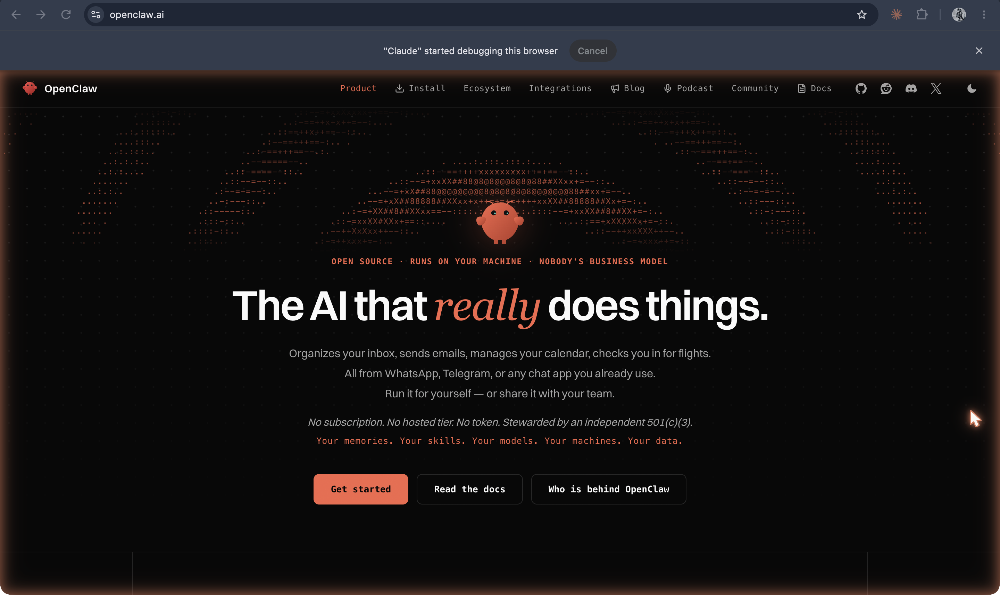

## What it shows

An [agent](../glossary/interfaces-and-agents/agent.md) is a model in a loop, with somewhere to keep notes, something it can do, and instructions it can load when it needs them. Seeing that anatomy small makes the large ones legible, including [Claude Code](../glossary/interfaces-and-agents/claude-code.md), which students already use. The [table at the end](#mini-claw-and-claude-code-side-by-side) is the point of the experiment.

## Try it

1. Open [/mini-claw](/mini-claw). The panel on the right is the agent's workspace, the folder `mini-claw/` at the root of this repo: its `memory.md`, its skills, its notes.
2. Pick a starter task, or write your own, and press **Run**. The trace below fills in step by step: the context assembled before the loop, then each call to the model (open "What the model received" to see the whole conversation as the model gets it), each tool call, the [permission](../glossary/interfaces-and-agents/permissions.md) it passed or failed, the result, and at the end `memory.md` before and after, with the new line highlighted.
3. Run **Remember something**, then **Use the memory**. The second run starts with no conversation at all; it knows about your paper only because the first run wrote a line to `memory.md`. That file is the agent's whole [memory](../glossary/interfaces-and-agents/memory.md).
4. Run **Keep a passage**: the agent should load the `commonplace-book` skill and file the quotation in `notes/commonplace.md`.
5. Run **Try to escape**: it asks for a file outside the workspace, and the tool refuses.

**Model.** "Claude" uses `CHAT_MODEL` and `OPENROUTER_API_KEY` from `nextjs/.env.local`, the same as [`/api/chat`](/chat-demo). Without a key, choose the **scripted stand-in**: a script, not a model, which tries to read any path named in the task and then makes the same four tool calls whatever you type (read a skill, append to memory, list notes, write a note). It runs through exactly the same loop, which makes a point of its own: the loop can't tell a script from a model, because all it ever receives is text or a tool call.

**Reset.** Demo notes in `mini-claw/notes/` are gitignored. `memory.md` is tracked, so `git diff mini-claw/memory.md` shows what the agent has learned and `git checkout -- mini-claw/memory.md` gives it a fresh start.

## What's in it

| File | What it is |
| --- | --- |
| `nextjs/app/api/mini-claw/agent.mjs` | **The loop**, about sixty lines, commented to be read in class |
| `nextjs/app/api/mini-claw/workspace.mjs` | **The one tool**, `file`, with its path checks and its permission table |
| `mini-claw/memory.md` | Read into the prompt at the start of every run; the agent may append one line at a time |
| `mini-claw/skills/*.md` | Three [skills](../glossary/interfaces-and-agents/skills.md): `remember`, `take-a-note`, `commonplace-book` |
| `mini-claw/notes/` | Where the agent writes |
| `nextjs/app/api/mini-claw/route.js` | `GET` returns the workspace; `POST { task, engine }` runs the agent once and streams the trace, one JSON event per line |
| `nextjs/app/api/mini-claw/scripted-model.mjs` | The scripted stand-in |
| `nextjs/app/api/mini-claw/mini-claw.test.mjs` | Tests: escapes, symlinks, permissions, and a full run of the loop (`node --test app/api/mini-claw/mini-claw.test.mjs` from `nextjs/`) |

### The loop

The [agent loop](../glossary/interfaces-and-agents/agent-loop.md) in `agent.mjs` does four things:

1. **Assemble the context.** Read `memory.md` and put it in the system prompt whole. Put each skill in as one line (its name, path, and description), not its full text.
2. **Call the model** with the system prompt, the tool's definition, and every message so far.
3. **If the reply has no [tool call](../glossary/interfaces-and-agents/tool-call.md), stop.** The model has answered in words.
4. **Otherwise run the tool**, add the [result](../glossary/interfaces-and-agents/tool-result.md) to the messages, and go back to 2. A limit of ten steps is the backstop [stopping condition](../glossary/interfaces-and-agents/stopping-condition.md).

The tool is given to the AI SDK without an `execute` function, so the SDK hands each call back instead of running it, and the loop is written out by hand where students can see it. The SDK can run this loop itself (`stopWhen`); writing it out is the lesson. Everything the page shows is the [trace](../glossary/interfaces-and-agents/trace.md) the loop reports as it goes.

### The one tool and its permissions

One tool, `file`, with four actions. Every path is resolved and checked before anything is touched: absolute paths, `../`, and symlinks that lead out of `mini-claw/` are refused, and so are hidden files. There is no shell, no network, and no delete. Then a four-line permission table applies:

| Action | Allowed |
| --- | --- |
| `list`, `read` | anywhere in `mini-claw/` |
| `write` (create or replace) | only Markdown files in `notes/` |
| `append` | `memory.md`, one line at a time, or Markdown files in `notes/` |

So the agent can add to its memory but not rewrite it, and it can read its skills but never change them. A refusal goes back to the model as the tool result ("Refused: …"), and the model has to work with it, as Claude Code does when a permission is denied.

Skills are loaded with the same tool: the model reads `skills/<name>.md` when it decides the task needs it. That is [progressive disclosure](../glossary/interfaces-and-agents/progressive-disclosure.md): the one-line descriptions are always in context, the full instructions only when used.

## Mini-claw and Claude Code side by side

| Part | mini-claw | Claude Code |
| --- | --- | --- |
| **The [harness](../glossary/interfaces-and-agents/harness.md)** | `agent.mjs` and `route.js`: a Next route on Marlon's laptop | The Claude Code program: "the layer around the model that provides the tools and manages the context the model sees" ([how it works](https://code.claude.com/docs/en/how-claude-code-works)) |
| **Standing instructions** ([CLAUDE.md / AGENTS.md](../glossary/interfaces-and-agents/instruction-files.md)) | A system prompt written in `agent.mjs`, the same every run | `CLAUDE.md` files from the working folder and every folder above it, concatenated into context; `AGENTS.md` is read when there is no `CLAUDE.md`, or imported with `@AGENTS.md` (as this repo does) ([memory docs](https://code.claude.com/docs/en/memory)) |
| **[Memory](../glossary/interfaces-and-agents/memory.md)** | `mini-claw/memory.md`, read whole at the start, appended to by the agent | Auto memory: a `MEMORY.md` index in `~/.claude/projects/<project>/memory/`, the first 200 lines (or 25 KB) loaded every session, with topic files read on demand ([memory docs](https://code.claude.com/docs/en/memory)) |
| **[Skills](../glossary/interfaces-and-agents/skills.md)** | `mini-claw/skills/*.md`, a `name` and `description` in the frontmatter; descriptions in the prompt, the file read with the tool when needed | `.claude/skills/<name>/SKILL.md`, the same frontmatter; "skill descriptions are loaded into context … full skill content only loads when invoked" ([skills docs](https://code.claude.com/docs/en/skills)) |
| **[Tools](../glossary/interfaces-and-agents/tool-use.md)** | One: `file` (list, read, write, append) inside `mini-claw/` | Many, in five kinds: file operations, search, execution (the shell), web, and code intelligence, plus subagents and questions to you ([how it works](https://code.claude.com/docs/en/how-claude-code-works)); more through MCP and plugins |
| **[Permissions](../glossary/interfaces-and-agents/permissions.md)** | A path check and a four-line table in `workspace.mjs`, fixed in code; no asking | Allow, ask, and deny rules in `settings.json`, "evaluated in order: deny, then ask, then allow" ([permissions docs](https://code.claude.com/docs/en/permissions)), and permission modes (Manual, Accept edits, Plan, Auto) that set what it may do without asking you |
| **[The loop](../glossary/interfaces-and-agents/agent-loop.md)** | `for` up to ten steps: call the model, run the tool, feed back the result, stop when there is no tool call | "Gather context, take action, and verify results", repeating until the task is done; "each tool use returns information that feeds back into the loop" ([how it works](https://code.claude.com/docs/en/how-claude-code-works)) |
| **Who is in the loop** | Nobody: one task, then it runs to the end (you can press Stop) | You: "You can interrupt at any point to steer Claude" ([how it works](https://code.claude.com/docs/en/how-claude-code-works)), and you answer permission prompts |
| **The [trace](../glossary/interfaces-and-agents/trace.md)** | The whole of `/mini-claw` | The transcript in your terminal, where each tool call and its result appear |
| **The model** | Claude through OpenRouter (`CHAT_MODEL`), or the scripted stand-in | Claude, chosen with `/model` |

Claude Code's details were checked against its documentation on 2026-10-19; they change often.

## The agents of 2026

Mini-claw's anatomy, a loop, a memory file, skills, and tools, is what the personal agents of 2026 sell, with the tools widened to a whole computer and the network. Captions and dates are from the [history page](../history/05-agentic-turn.md), which gives each date's source.

**OpenClaw** (named OpenClaw on 29 Jan 2026): an open-source agent that runs on your own machine.

**Hermes Agent** (Nous Research, released 25 Feb 2026): its repository documents memory, skill creation, tools, and messaging. "Self-improving" does not mean it retrains its weights; it appears to mean the agent adds to its own skills and memory (verify). Mini-claw's permission table lets it add to memory but forbids it to touch its skills.

**Grok Bot** (announced 11 Aug 2026): always-on agents with their own cloud computer.

**Muse** (Meta, 8 Sep 2026): a personal agent on a cloud virtual machine with a browser.

**dots** (OpenAI, 29 Sep 2026): persistent agents with a cloud computer and connected apps.

## A safety note

[The lethal trifecta](../glossary/interfaces-and-agents/lethal-trifecta.md) is Simon Willison's name for an agent that combines access to private data, exposure to untrusted content, and the ability to communicate externally: a [prompt injection](../glossary/interfaces-and-agents/prompt-injection.md) in the untrusted content can then send the private data away. Mini-claw is built to lack the third leg: no network, no shell, and writes only inside its own folder. Its memory is private in a small way, and anything pasted into a task is untrusted, so the other two legs are present. The agents above have all three by design. Students should not install real personal agents for this; demos of those happen live from a dedicated machine.

## Open questions

- The Claude path is untested: there was no `OPENROUTER_API_KEY` in `nextjs/.env.local` (or in The Notebook's toolbox) when this was built. The loop, the tool, and the trace were tested end to end with the scripted stand-in through the same `generateText` call. With a key, check that Claude loads skills unprompted and that "Try to escape" produces a sensible reply to the refusal.
- Should a run be able to continue as a conversation? Each run is a single task on purpose, so `memory.md` is visibly the only thing that carries over.
- Ask before acting: a Claude Code–style permission prompt (pause the loop, ask on the page, resume) would make the permissions row more vivid. The AI SDK supports this (`toolApproval`), at the cost of a longer loop.
- For class: a "reset memory" button, so `memory.md` doesn't have to be restored from git between demos?
