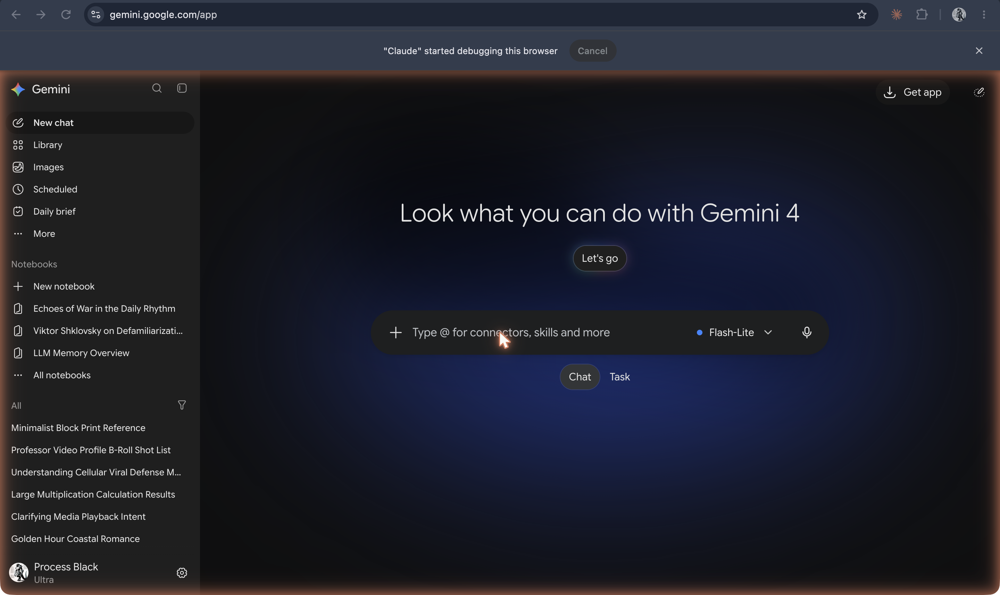

# Bard and Gemini

**Google's chatbot, announced as Bard in February 2023 and opened to the public in the US and UK on 21 March 2023, first running on a lightweight version of LaMDA; renamed Gemini on 8 February 2024.**

## In plain terms

Google had the dialogue model before it had the product. LaMDA, its conversation model, was described in a research paper in January 2022 (see [LaMDA](lamda.md)). After ChatGPT, Google turned it into a product: on 6 February 2023 Sundar Pichai announced "an experimental conversational AI service, powered by LaMDA, that we're calling Bard," open first to trusted testers. On 21 March 2023 Google began opening access in the US and UK, describing Bard as "an early experiment that lets you collaborate with generative AI," powered by "a lightweight and optimized version of LaMDA."

On 8 February 2024 Google dropped the name: "Bard will now simply be known as Gemini," matching the name of its newer model family, with a mobile app and a paid tier. The product and the model now share one name, which makes it easy to confuse the chatbot with what runs underneath it.

## Where it fits

**Post-training and platform.** Bard is Google's dialogue research (LaMDA) turned into a ChatGPT-style assistant. As Gemini it became Google's home for configuration features, from Gems to notebooks, and the 2026 screenshot shows them in its sidebar.

## In the readings

The LaMDA paper describes the model Bard first ran on: "a family of Transformer-based neural language models specialized for dialog," fine-tuned for "safety and factual grounding" and able to "consult external knowledge sources," with an analysis of "helpfulness and role consistency" ([Thoppilan et al. 2022, abstract](https://github.com/ll-26-27/eng-298ai-context/blob/24df8b8/_context/LL-readings/papers-on-ai-md/2201.08239v3--lamda-language-models-for-dialog-applications.md#L97)).

## Try it

The configuration layer in [the layers](/layers) is what Gemini's Gems package. The "Course TF Assistant" built as a Gem is in the [history screenshots](../../history/README.md).

## See also

[LaMDA](lamda.md) · [ChatGPT](chatgpt.md) · [Gems](gems.md) · [NotebookLM](notebooklm.md) · [Assistant](../persona-and-dialogue/assistant.md)

## Sources

- Sundar Pichai, ["An important next step on our AI journey"](https://blog.google/technology/ai/bard-google-ai-search-updates/), Google, 6 February 2023: Bard announced, "powered by LaMDA," opened to trusted testers.
- Sissie Hsiao and Eli Collins, ["Try Bard and share your feedback"](https://blog.google/technology/ai/try-bard/), Google, 21 March 2023: public access starting in the US and UK, "early experiment," "lightweight and optimized version of LaMDA."
- Sissie Hsiao, ["Bard becomes Gemini: Try Ultra 1.0 and a new mobile app today"](https://blog.google/products/gemini/bard-gemini-advanced-app/), Google, 8 February 2024: the rename, the mobile app, Gemini Advanced.
- Romal Thoppilan et al., ["LaMDA: Language Models for Dialog Applications"](https://arxiv.org/abs/2201.08239) (arXiv, January 2022).
- Screenshot `32-gemini-home-2026.png` (captured 19 October 2026): the service running under the Gemini name; the basis for status "renamed" (Bard) with the product still active.
