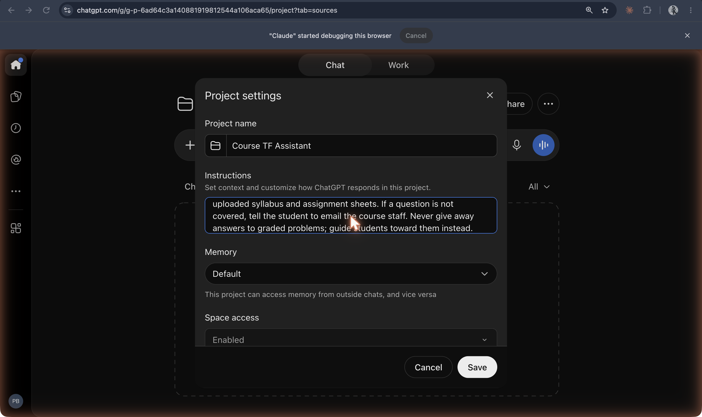

# ChatGPT Projects

**Folders in ChatGPT, introduced 13 December 2024, that group chats and files under shared instructions; OpenAI's version of the project idea, later given its own memory setting.**

## In plain terms

A ChatGPT project is a folder for chats. You give it a name, instructions ("Set context and customize how ChatGPT responds in this project"), and files, and every chat inside it starts from them. OpenAI revealed the feature at the end of a livestream on 13 December 2024 and began rolling it out that day to Plus, Pro, and Team users; coverage at the time compared it to a Notion or Google Drive folder.

The October 2026 settings in the screenshot show how far the idea has grown: besides instructions there is a Memory setting ("This project can access memory from outside chats, and vice versa") and a "Space access" setting. The project's Sources tab holds its files ([screenshot 11](../../history/_images/11-chatgpt-project-page-sources.png)).

## Where it fits

**Configuration and memory.** Projects arrived a year after OpenAI's own custom GPTs and six months after Claude Projects, and they converge on the same shape: instructions plus files over a set of chats, for the owner rather than for a public store. The memory setting ties this configuration layer to ChatGPT's account-wide memory.

## Try it

[The layers](/layers) builds the same Course TF Assistant as a custom GPT, a Claude project, and a Gem.

## See also

[ChatGPT](chatgpt.md) · [Custom GPTs](custom-gpts.md) · [Claude Projects](claude-projects.md) · [Gems](gems.md) · [Projects](../interfaces-and-agents/projects.md) · [Custom instructions](../interfaces-and-agents/custom-instructions.md) · [Knowledge files](../interfaces-and-agents/knowledge-files.md) · [Memory](../interfaces-and-agents/memory.md)

## Sources

- Cody Corrall, ["ChatGPT now has Projects to organize your chats"](https://techcrunch.com/?p=2931159), TechCrunch, 13 December 2024 (contemporaneous press): the date, the livestream, files and instructions, the rollout to Plus, Pro, and Team users. OpenAI's own announcement (part of its "12 Days" series) was not opened (verify against it).
- Screenshots `10-chatgpt-project-settings-instructions.png` and `11-chatgpt-project-page-sources.png`, captured 19 October 2026: the instructions, Memory, and Space access settings and the Sources tab. When project-level memory was added is not sourced here (verify).
