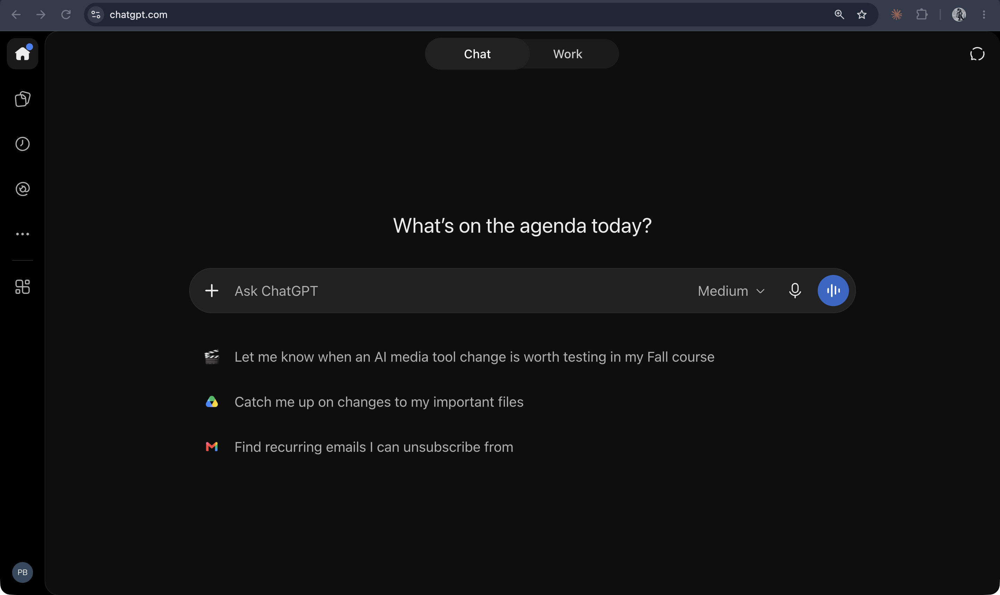

# ChatGPT

**OpenAI's chat interface to a language model fine-tuned for dialogue with reinforcement learning from human feedback, released free as a "research preview" on 30 November 2022.**

## In plain terms

ChatGPT put a text box in front of a model from the GPT-3.5 series and let anyone type to it. The launch post's first sentence describes the product as a format: "We've trained a model called ChatGPT which interacts in a conversational way. The dialogue format makes it possible for ChatGPT to answer followup questions, admit its mistakes, challenge incorrect premises, and reject inappropriate requests."

The training is the part that made it an assistant rather than a text-continuer. OpenAI says it used "the same methods as InstructGPT, but with slight differences in the data collection setup": human trainers wrote conversations in which they "played both sides—the user and an AI assistant," then ranked alternative model replies, and those rankings trained a reward model that steered the final fine-tuning. The same post lists the limits plainly: "plausible-sounding but incorrect or nonsensical answers," sensitivity to rephrasing, verbosity, and a habit of "restating that it's a language model trained by OpenAI."

Ask a base model "Who are you?" and it keeps writing the document ([the GPT-2 experiment](/gpt-2)); ask ChatGPT and a character answers. That difference is the whole of post-training, seen from the outside.

## Where it fits

**Post-training.** ChatGPT is where the assistant persona built by instruction tuning and RLHF met the public through a plain chat window, and the interface became the default shape for talking to language models. Nearly every later product on this list is either a response to it or a layer added on top of it (custom instructions, [custom GPTs](custom-gpts.md), projects, plugins).

## In the readings

The InstructGPT paper is ChatGPT's direct ancestor, the "sibling model" its launch post links to. Its abstract states the problem post-training solves: "Making language models bigger does not inherently make them better at following a user's intent," and reports that outputs from a 1.3-billion-parameter InstructGPT model were preferred to those of the 175-billion-parameter GPT-3 ([Ouyang et al. 2022, abstract](https://github.com/ll-26-27/eng-298ai-context/blob/24df8b8/_context/LL-readings/papers-on-ai-md/2203.02155v1--training-language-models-to-follow-instructions-with-human-feedback.md#L59)).

## Try it

[The layers](/layers) bolts configuration, memory, and tools onto one engine, the way ChatGPT's later features were added around its model. The [persona dial](/persona-dial) keeps the engine fixed and changes only the presentation: name, avatar, typing indicator, feelings language.

## See also

[InstructGPT](../people-and-texts/instructgpt.md) · [RLHF](../models-and-training/rlhf.md) · [Assistant](../persona-and-dialogue/assistant.md) · [Chat interface](../interfaces-and-agents/chat-interface.md) · [Custom GPTs](custom-gpts.md) · [Claude](claude-ai.md)

## Sources

- OpenAI, ["Introducing ChatGPT"](https://openai.com/index/chatgpt/) (30 November 2022; originally titled "ChatGPT: Optimizing Language Models for Dialogue," as in the [Wayback capture of launch day](https://web.archive.org/web/20221130211011/https://openai.com/blog/chatgpt/) shown in the screenshot above, whose URL bar gives this address): the date, free research preview, the opening description, "sibling model to InstructGPT," the RLHF method (trainers playing both sides, ranked comparisons, reward models, PPO), fine-tuning from a GPT-3.5-series model, and the listed limitations.
- Long Ouyang et al., ["Training language models to follow instructions with human feedback"](https://arxiv.org/abs/2203.02155) (arXiv, March 2022): the InstructGPT method and the 1.3B-versus-175B preference result.
- Screenshot `30-chatgpt-home-2026.png` (captured 19 October 2026) shows the service running; status "active" rests on that capture and on OpenAI's current product pages linked from the launch post.
