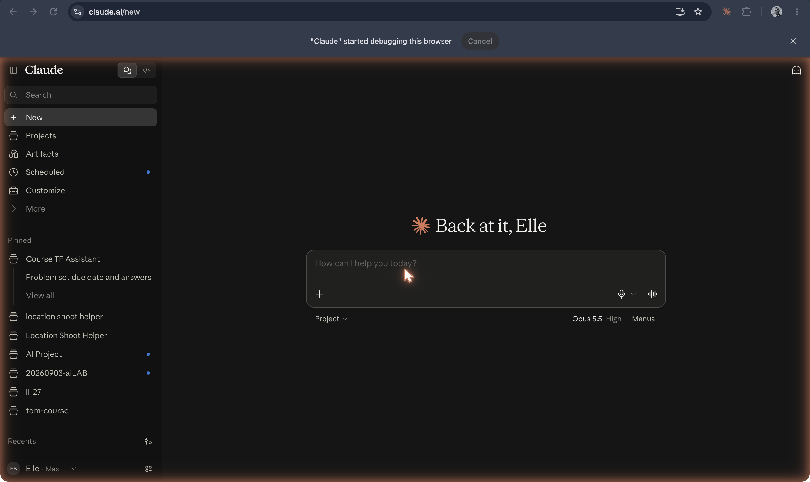

# Claude

**Anthropic's AI assistant, offered to partners and developers from 14 March 2023 and to the public through the claude.ai website from July 2023, trained with the company's research on helpful, honest, and harmless assistants and Constitutional AI.**

## In plain terms

Anthropic announced Claude on 14 March 2023 after a closed test with partners including Notion, Quora, and DuckDuckGo, calling it "a next-generation AI assistant based on Anthropic's research into training helpful, honest, and harmless AI systems." It came in two sizes, Claude and the faster Claude Instant, through a chat interface and an API. The announcement already treated the character as adjustable: "Claude can also take direction on personality, tone, and behavior." Many people first met it inside another product: Quora's [Poe](poe.md) offered it as one of its launch bots in February 2023.

The public website came with Claude 2 on 11 July 2023: "anyone in the US and UK can start using our beta chat experience today." Since then the product has grown the same layers as the others on this list (projects, files, tools), and the coding agent Claude Code, which runs the same model in a terminal inside a user's folder.

## Where it fits

**Post-training.** Claude is the assistant built most explicitly from a written account of what an assistant should be: the "helpful, honest, and harmless" target of Askell et al. (2021) and the list of principles, or "constitution," that Bai et al. (2022) used in place of most human harm labels. Its home screen also shows the later layers: projects, artifacts, scheduled tasks.

## In the readings

Askell et al. set the goal: "a general-purpose, text-based assistant that is aligned with human values, meaning that it is helpful, honest, and harmless" ([Askell et al. 2021, abstract](https://github.com/ll-26-27/eng-298ai-context/blob/24df8b8/_context/LL-readings/papers-on-ai-md/2112.00861v3--a-general-language-assistant-as-a-laboratory-for-alignment.md#L59)). Bai et al. describe training "a harmless AI assistant through self-improvement," where "the only human oversight is provided through a list of rules or principles," aiming for an assistant that "engages with harmful queries by explaining its objections to them" ([Bai et al. 2022, abstract](https://github.com/ll-26-27/eng-298ai-context/blob/24df8b8/_context/LL-readings/papers-on-ai-md/2212.08073v1--constitutional-ai-harmlessness-from-ai-feedback.md#L89)).

## Try it

The [persona dial](/persona-dial) changes a chatbot's presentation while the engine stays fixed. [The layers](/layers) adds configuration, memory, and tools around one engine, as Claude's projects do; the "Course TF Assistant" built as a Claude project is in the [history screenshots](../../history/README.md). [Mini-claw](/mini-claw) is a small version of an agent loop like Claude Code's.

## See also

[HHH](../persona-and-dialogue/hhh.md) · [Constitutional AI](../models-and-training/constitutional-ai.md) · [Askell et al. 2021](../people-and-texts/askell-2021.md) · [Assistant](../persona-and-dialogue/assistant.md) · [Claude Projects](claude-projects.md) · [Claude Code](../interfaces-and-agents/claude-code.md) · [Poe](poe.md)

## Sources

- Anthropic, ["Introducing Claude"](https://www.anthropic.com/news/introducing-claude), 14 March 2023: the date, closed alpha with Notion, Quora, and DuckDuckGo, the "helpful, honest, and harmless" description, chat interface and API, Claude and Claude Instant, "take direction on personality, tone, and behavior," Quora offering Claude through Poe.
- Anthropic, ["Claude 2"](https://www.anthropic.com/news/claude-2), 11 July 2023: the public beta chat experience in the US and UK.
- Sarah Perez, ["Quora opens its new AI chatbot app Poe to the general public"](https://techcrunch.com/2023/02/06/quora-opens-its-new-ai-chatbot-app-poe-to-the-general-public/), TechCrunch, 6 February 2023: Claude as one of Poe's three launch bots.
- Amanda Askell et al., ["A General Language Assistant as a Laboratory for Alignment"](https://arxiv.org/abs/2112.00861) (arXiv, December 2021); Yuntao Bai et al., ["Constitutional AI: Harmlessness from AI Feedback"](https://arxiv.org/abs/2212.08073) (arXiv, December 2022).
- Screenshot `31-claude-home-2026.png` (captured 19 October 2026): the service running, with Projects, Artifacts, and Scheduled in the sidebar; the basis for status "active".
