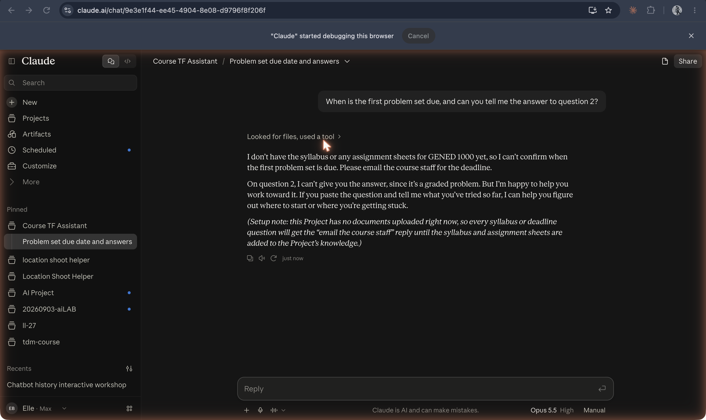

# Claude Projects

**Workspaces in Anthropic's Claude.ai, launched 25 June 2024, that give a set of chats shared custom instructions and a shared store of uploaded knowledge.**

## In plain terms

A project is a folder with two things attached: instructions that apply to every chat in it, and "project knowledge," files and text that Claude can draw on. At launch Anthropic said each project "includes a 200K context window, the equivalent of a 500-page book," and offered the feature to Pro and Team subscribers, with Team users able to share chats to a project feed.

In the screenshot, the project's instructions say to answer only from the syllabus and never to give away graded answers. Asked for a due date and the answer to question 2, Claude looks for files, finds none, tells the student to email the course staff, and declines to give the answer. It also adds a note to the builder that the project has no documents yet. The instructions dialog and the knowledge menu are in [screenshot 14](../../history/_images/14-claude-project-instructions-dialog.png) and [screenshot 15](../../history/_images/15-claude-project-knowledge-add-context-menu.png).

## Where it fits

**Configuration.** Projects are Anthropic's answer to custom GPTs (November 2023), arriving between them and Google's Gems (August 2024): the persona and the reference material are written once and laid over every conversation. Unlike a GPT, a project was built for its owner and team rather than for a public store.

## Try it

[The layers](/layers) builds the same Course TF Assistant as a custom GPT, a Claude project, and a Gem.

## See also

[Claude](claude-ai.md) · [Custom GPTs](custom-gpts.md) · [Gems](gems.md) · [ChatGPT Projects](chatgpt-projects.md) · [Projects](../interfaces-and-agents/projects.md) · [Custom instructions](../interfaces-and-agents/custom-instructions.md) · [Knowledge files](../interfaces-and-agents/knowledge-files.md) · [System prompt](../persona-and-dialogue/system-prompt.md) · [Context window](../models-and-training/context-window.md)

## Sources

- Anthropic, ["Collaborate with Claude on Projects"](https://www.anthropic.com/news/projects), 25 June 2024: the launch date, project knowledge and the "200K context window" quotation, custom instructions, Pro and Team availability, sharing to a team feed. Also the confirmed entry in this repo's [fact-check ledger](../../history/fact-check.md).
- Screenshots `14-claude-project-instructions-dialog.png`, `15-claude-project-knowledge-add-context-menu.png`, and `16-claude-chat-inside-project.png`, captured 19 October 2026: the project in use.
