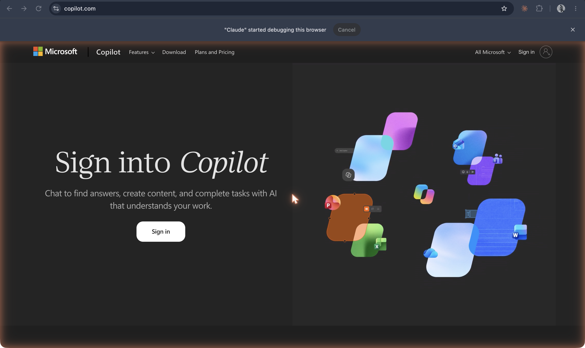

# Microsoft Copilot

**Microsoft's name, from September 2023, for its consumer AI assistant across Windows, Edge, Bing, and Microsoft 365, billed as "your everyday AI companion"; Bing Chat was folded into it in November 2023.**

## In plain terms

"Copilot" began as a metaphor in Microsoft's launch of the new Bing in February 2023 ("your copilot for the web") and became a product name on 21 September 2023: "we take the next step to unify these capabilities into a single experience we call Microsoft Copilot, your everyday AI companion." It began rolling out in Windows 11 on 26 September 2023, and "across Bing, Edge, and Microsoft 365 Copilot this fall." On 15 November 2023 Microsoft added the last piece: "Bing Chat and Bing Chat Enterprise will now simply become Microsoft Copilot." The chatbot that had called itself Sydney nine months earlier was now one brand among Microsoft's assistants.

In March 2024 Microsoft hired Mustafa Suleyman, co-founder of Inflection AI and its companion chatbot [Pi](pi.md), as CEO of a new Microsoft AI organization "focused on advancing Copilot and our other consumer AI products," with the Copilot, Bing, and Edge teams reporting to him.

## Where it fits

**Platform and companionship.** Copilot is the assistant as an operating-system feature: one name stretched across a search engine, a browser, an office suite, and Windows itself. Microsoft's chosen word for it, "companion," and its choice of Pi's founder to lead it, show the companion persona moving from a startup's chatbot into the largest software platform.

## See also

[Bing Chat and "Sydney"](bing-chat.md) · [Pi](pi.md) · [ChatGPT](chatgpt.md) · [Companion](../persona-and-dialogue/companion.md) · [Assistant](../persona-and-dialogue/assistant.md)

## Sources

- Yusuf Mehdi, ["Announcing Microsoft Copilot, your everyday AI companion"](https://blogs.microsoft.com/blog/2023/09/21/announcing-microsoft-copilot-your-everyday-ai-companion/), Official Microsoft Blog, 21 September 2023, with its update note of 15 November 2023: the name, "everyday AI companion," the Windows 11 rollout from 26 September, Bing, Edge, and Microsoft 365, and Bing Chat becoming Copilot.
- Microsoft, ["Reinventing search with a new AI-powered Microsoft Bing and Edge, your copilot for the web"](https://blogs.microsoft.com/blog/2023/02/07/reinventing-search-with-a-new-ai-powered-microsoft-bing-and-edge-your-copilot-for-the-web/), 7 February 2023: the earlier "copilot for the web" phrasing.
- Satya Nadella, ["Mustafa Suleyman, DeepMind and Inflection Co-founder, joins Microsoft to lead Copilot"](https://blogs.microsoft.com/blog/2024/03/19/mustafa-suleyman-deepmind-and-inflection-co-founder-joins-microsoft-to-lead-copilot/), Official Microsoft Blog, 19 March 2024.
- Screenshot `34-microsoft-copilot-signin-landing-2026.png` (captured 19 October 2026; sign-in page only, not signed in): the service running; the basis for status "active". The product inside the sign-in was not captured.
