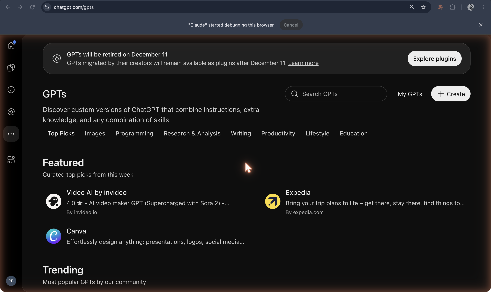
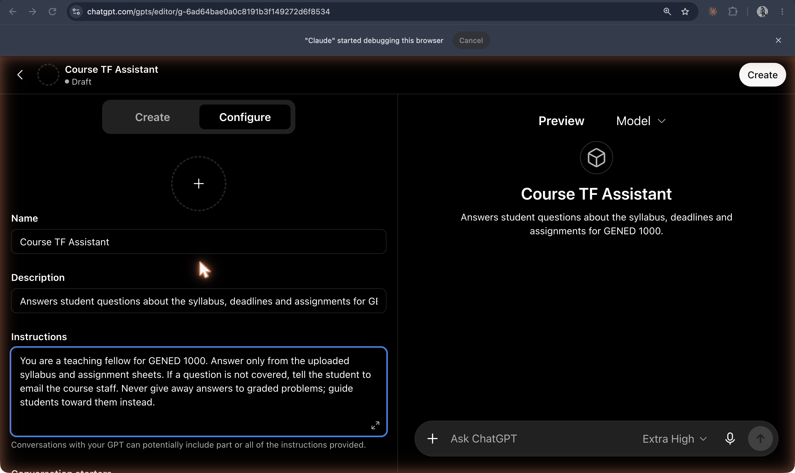

# Custom GPTs

**Versions of ChatGPT that anyone could configure with instructions, knowledge files, and capabilities, announced at OpenAI's DevDay on 6 November 2023 and listed in the GPT Store from January 2024; OpenAI plans to retire them on 11 December 2026 in favor of plugins.**

## In plain terms

OpenAI's announcement put it in one sentence: "You can now create custom versions of ChatGPT that combine instructions, extra knowledge, and any combination of skills." No code was required. A builder named the GPT, wrote its instructions, uploaded files, and ticked capabilities such as web search, image generation, or data analysis; developers could add "actions" that called outside APIs. OpenAI presented it as the next step after custom instructions (July 2023), because "many power users maintain a list of carefully crafted prompts and instruction sets, manually copying them into ChatGPT. GPTs now do all of that for you."

The "Course TF Assistant" is a custom GPT in this sense. Its Configure tab holds a name, a one-line description, and the instructions: "You are a teaching fellow for GENED 1000. Answer only from the uploaded syllabus and assignment sheets… Never give away answers to graded problems; guide students toward them instead." Below the box the builder warns: "Conversations with your GPT can potentially include part or all of the instructions provided." The model is ChatGPT's; everything that makes it a TF is configuration.

The GPT Store opened on 10 January 2024, when OpenAI reported that users had "already created over 3 million custom versions of ChatGPT." In 2026 OpenAI announced their retirement: custom GPTs "are scheduled to retire on Dec 11, 2026," and migration turns a GPT's instructions into "a skill within the new plugin" and its knowledge files into reference files.

## Where it fits

**Configuration.** Custom GPTs made the configuration layer (a system prompt, a set of documents, a choice of tools) into a named, shareable product with its own page in a store. Poe's prompt bots came first; Gems and projects followed; and the planned move from GPTs to plugins and skills shows the same layer being renamed and reorganized.

## Try it

The configuration panel in [the layers](/layers) (a system prompt, attached files, one tool) is a custom GPT reduced to its parts. The "Course TF Assistant" built as a custom GPT, a Claude project, and a Gem is in the [history screenshots](../../history/README.md).

## See also

[ChatGPT](chatgpt.md) · [Poe](poe.md) · [Gems](gems.md) · [Claude Projects](claude-projects.md) · [ChatGPT Projects](chatgpt-projects.md) · [Custom instructions](../interfaces-and-agents/custom-instructions.md) · [System prompt](../persona-and-dialogue/system-prompt.md) · [Knowledge files](../interfaces-and-agents/knowledge-files.md) · [Plugins](../interfaces-and-agents/plugins.md) · [Skills](../interfaces-and-agents/skills.md)

## Sources

- OpenAI, ["Introducing GPTs"](https://openai.com/index/introducing-gpts/), 6 November 2023: the one-sentence description, no-code building, capabilities, actions, the custom-instructions comparison and quotation, the GPT Store promised for later that month. (Task J's ledger confirms this source for the late-2023 date.)
- OpenAI, ["Introducing the GPT Store"](https://openai.com/index/introducing-the-gpt-store/), 10 January 2024: the store's launch for Plus, Team, and Enterprise users and the "over 3 million" figure. This confirms the shot list's "GPT Store: 10 Jan 2024 (verify)".
- OpenAI Help Center, ["Custom GPT retirement and migration FAQ"](https://help.openai.com/en/articles/20001519-custom-gpt-retirement-and-migration-faq) (read 19 October 2026): retirement scheduled for 11 December 2026 (11 February 2027 for Enterprise workspaces with an approved deferral), migration of instructions to a skill and knowledge to reference files, custom actions not transferred. The status is "active" because GPTs still run as of 19 October 2026; the dates are OpenAI's plan and "subject to change."
- Screenshots `03-gpt-store-gallery-with-retirement-banner.png` and `06-gpt-builder-configure-tab.png` (captured 19 October 2026): the banner text and the "Course TF Assistant" configuration, as displayed.
