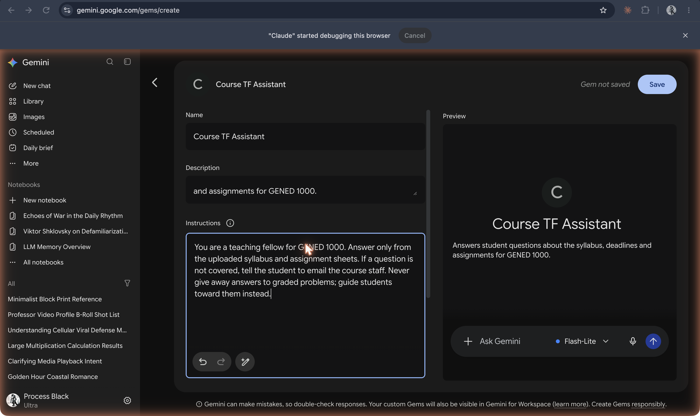

# Gems

**Custom versions of Google's Gemini, made by writing instructions, naming the result, and adding knowledge files; previewed at I/O in May 2024, released 28 August 2024, and being migrated to Gemini skills from 17 November 2026.**

## In plain terms

A Gem is Gemini with a standing set of instructions. Google's launch post put it in one line: "Simply write instructions for your Gem, give it a name, and then chat with it whenever you want." The editor in the screenshot has three fields (name, description, instructions) and a preview pane; the instructions here are the same ones given to the custom GPT and the Claude project in the layers experiment: "You are a teaching fellow for GENED 1000. Answer only from the uploaded syllabus and assignment sheets…" Further down the page are a default tool and a Knowledge section for files ([screenshot 20](../../history/_images/20-gemini-gem-editor-knowledge.png)).

Google announced Gems at I/O on 14 May 2024 ("customized versions of Gemini"), released them to paying Gemini Advanced, Business, and Enterprise users on 28 August 2024 with a set of premade Gems, and later opened them to free users (verify the date). In October 2026 the Gems page carries a banner: "Gems will become skills starting Nov 17, 2026 … we'll automatically begin migrating your Gems to skills" ([screenshot 17](../../history/_images/17-gemini-gems-gallery-with-skills-banner.png)).

## Where it fits

**Configuration.** Gems are Google's version of the configuration layer that OpenAI opened with custom GPTs in November 2023: a persona and a job written in plain language, laid over the same model. Their planned conversion into skills, reusable instructions the model can call when relevant, is one sign of the shift from configured chatbots to agents that load instructions as needed.

## Try it

[The layers](/layers) builds the same Course TF Assistant as a custom GPT, a Claude project, and a Gem, and puts the three side by side.

## See also

[Custom GPTs](custom-gpts.md) · [Claude Projects](claude-projects.md) · [ChatGPT Projects](chatgpt-projects.md) · [Bard and Gemini](bard-and-gemini.md) · [NotebookLM](notebooklm.md) · [Custom instructions](../interfaces-and-agents/custom-instructions.md) · [Knowledge files](../interfaces-and-agents/knowledge-files.md) · [System prompt](../persona-and-dialogue/system-prompt.md) · [Skills](../interfaces-and-agents/skills.md)

## Sources

- ["Google Gemini update: Access to 1.5 Pro and new features"](https://blog.google/products-and-platforms/products/gemini/google-gemini-update-may-2024/), Google blog, 14 May 2024 (Google I/O): "Gemini Advanced subscribers will soon be able to create Gems — customized versions of Gemini."
- Dave Citron, ["New in Gemini: Custom Gems and improved image generation with Imagen 3"](https://blog.google/products/gemini/google-gemini-update-august-2024/), Google blog, 28 August 2024: release to Gemini Advanced, Business, and Enterprise users, premade Gems, the "write instructions … give it a name" quotation.
- Nickolas Diaz, ["Gemini Gems are heading out: Google to replace them with 'Skills' in November"](https://www.androidcentral.com/apps-software/ai/gemini-gems-are-heading-out-google-to-replace-them-with-skills-in-november), Android Central, 29 September 2026 (secondary): Google's notice that Gems will be replaced by and migrated to skills. Google's own help page was not opened (verify the later dates for Workspace and education accounts).
- Screenshots `17-gemini-gems-gallery-with-skills-banner.png`, `19-gemini-gem-editor.png`, and `20-gemini-gem-editor-knowledge.png`, captured 19 October 2026: the banner text, the editor, and the Knowledge section.
