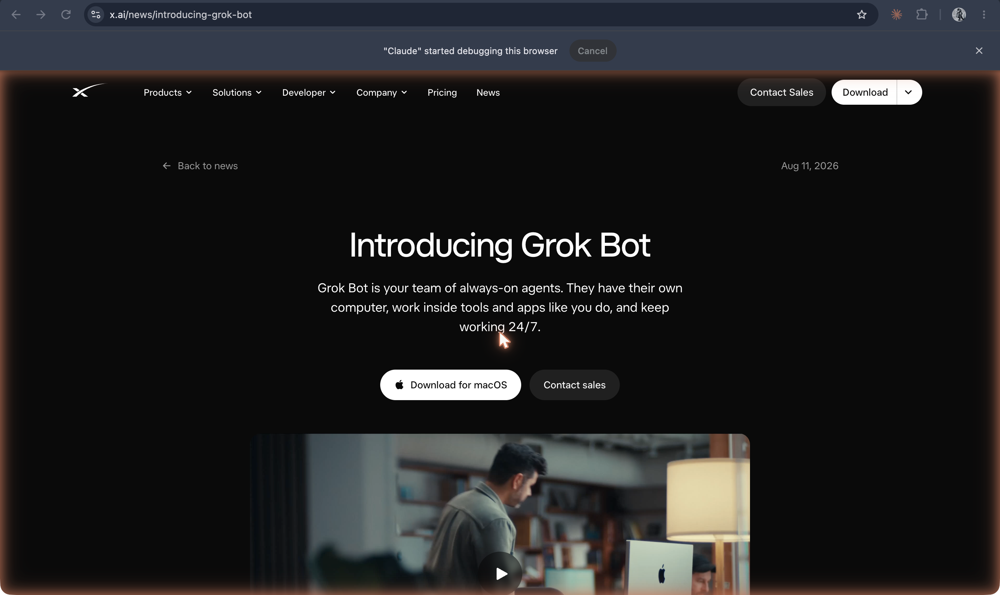

# Grok Bot

**xAI's team of always-on agents, launched in beta on 11 August 2026: Bots that share their own cloud computer, sign into your tools, remember how you work, and message each other.**

## In plain terms

The announcement opens: "Grok Bot is your team of always-on agents. They have their own computer, work inside tools and apps like you do, and keep working 24/7." You message a Bot like a colleague, from desktop or phone; it signs into your apps, works through the job, and "only come[s] back when something needs your approval." Bots "remember conversations, learn how you like things done," and can watch you do a task once and save it as a routine.

The "team" is literal. Bots can message one another, share context in threads, and work together in a group chat; xAI describes people running "a chief of staff" Bot over specialists. In Grok, a popup asks you to "Pick a primary Bot, the one you go to first. It checks in and works with your other Bots" ([screenshot 26](../../history/_images/26-grok-your-bots-are-in-grok-popup.png)). On X, mentioning @bot forwards a request to your own Grok Bot; "Unlike @Grok, @bot does not answer requests itself."

At launch it was in beta for SuperGrok and some Cursor subscribers on desktop and iOS, billed separately from those plans.

## Where it fits

**Agency.** Grok Bot is the first of three hosted launches in August and September 2026 (with Meta's [Muse](muse.md) and OpenAI's [dots](openai-dots.md)) that take the always-on agent from open-source projects like [OpenClaw](openclaw.md) into a hosted product: the agent's computer is in the vendor's cloud rather than on your machine, and the unit is a team of agents rather than one assistant.

## Try it

[Mini-claw](/mini-claw) builds a small always-on agent by hand, to show the parts these products package.

## See also

[Grok](grok.md) · [OpenClaw](openclaw.md) · [Hermes Agent](hermes-agent.md) · [Muse](muse.md) · [OpenAI's dots](openai-dots.md) · [Agent](../interfaces-and-agents/agent.md) · [Always-on agent](../interfaces-and-agents/always-on-agent.md) · [An agent's own computer](../interfaces-and-agents/agent-computer.md) · [Computer use](../interfaces-and-agents/computer-use.md) · [Memory](../interfaces-and-agents/memory.md) · [Subagent](../interfaces-and-agents/subagent.md) · [Human in the loop](../interfaces-and-agents/human-in-the-loop.md)

## Sources

- ["Introducing Grok Bot"](https://x.ai/news/introducing-grok-bot), x.ai, 11 August 2026, fetched 19 October 2026: the opening quotation, the shared cloud computer, memory and routines, Bots messaging each other, the "chief of staff" example, the beta and its subscriber tiers. The fetched page is titled "SpaceXSI," the name under which the company now publishes it (verify the corporate name). Also confirmed in this repo's [fact-check ledger](../../history/fact-check.md).
- X Help Center, ["About @bot"](https://help.x.com/en/using-x/about-bot): @bot forwards requests on X to a user's Grok Bot and does not answer itself.
- Screenshots `25-xai-introducing-grok-bot-aug2026.png` and `26-grok-your-bots-are-in-grok-popup.png`, captured 19 October 2026: the announcement and the "Your Bots are in Grok" popup at grok.com.
