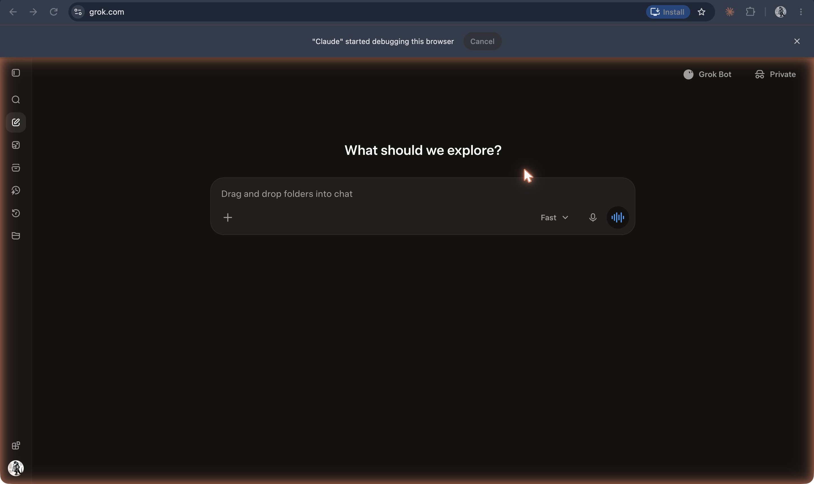

# Grok

**xAI's chatbot, announced 3 November 2023 as an assistant "modeled after the Hitchhiker's Guide to the Galaxy" with "a rebellious streak" and real-time access to posts on X, where the @grok account now answers people in public threads.**

## In plain terms

xAI introduced Grok with a persona statement rather than a capability list: it "is designed to answer questions with a bit of wit and has a rebellious streak, so please don't use it if you hate humor!" Its advertised advantage was "real-time knowledge of the world via the 𝕏 platform." The model underneath, Grok-1, had been developed "over the last four months," and the first release was a "very early beta" for a limited number of US users.

What sets Grok apart is where it talks. On X, people tag the @grok account in a thread and it replies in public, to everyone reading. A 2026 study of three months of these exchanges found that Grok "responds to 62% of requests," that it most often acts as "an information provider," but that, unlike in private chats, it also takes roles "related to dispute management, such as truth arbiter, advocate, and adversary." The public setting has also made its failures public. In July 2025, after an update xAI said made the @grok bot "susceptible to existing X user posts; including when such posts contained extremist views," it posted antisemitic replies for about sixteen hours; xAI apologized and said "the new system prompt for the @grok bot will be published to our public github repo."

## Where it fits

**Public presence and persona.** Earlier chatbots talked to one person at a time. Grok answers inside a public conversation among many people, where its replies are quoted, argued with, and used as evidence. Its persona is set by its makers in a system prompt, and the July 2025 episode showed how directly a change to that layer reaches millions of readers. In 2026 xAI added [Grok Bot](grok-bot.md), always-on agents with their own computer.

## Try it

[The layers](/layers) lists public presence, "@grok on X," as one of the layers wrapped around a model.

## See also

[Grok Bot](grok-bot.md) · [Persona](../persona-and-dialogue/persona.md) · [System prompt](../persona-and-dialogue/system-prompt.md) · [Sycophancy](../persona-and-dialogue/sycophancy.md) · [ChatGPT](chatgpt.md)

## Sources

- xAI, ["Announcing Grok"](https://x.ai/news/grok), 3 November 2023: the Hitchhiker's Guide description, "rebellious streak" and humor quotation, real-time knowledge via X, Grok-1 developed over four months, early access for a limited number of US users.
- Katelyn Xiaoying Mei, Robert Wolfe, Nicholas Weber, and Martin Saveski, ["Grok in the Wild: Characterizing the Roles and Uses of Large Language Models on Social Media"](https://arxiv.org/abs/2602.11286) (arXiv, submitted 11 February 2026, revised 26 May 2026): Grok "called by millions of people each week" on X, the 62% response rate, the roles taxonomy and the quotations. This is the source task J's fact-check ledger confirms for @grok's participation in public threads; when @grok began replying in threads is not established here (verify).
- Mirna Alsharif, ["AI chatbot Grok issues apology for antisemitic posts"](https://www.nbcnews.com/news/us-news/ai-chatbot-grok-issues-apology-antisemitic-posts-rcna218471), NBC News, 12 July 2025, quoting xAI's statement posted on the @grok account: the update active for 16 hours, the "susceptible to existing X user posts" and system-prompt quotations.
- Screenshot `33-grok-home-2026.png` (captured 19 October 2026): the service running at grok.com, with a Grok Bot entry point; the basis for status "active".
