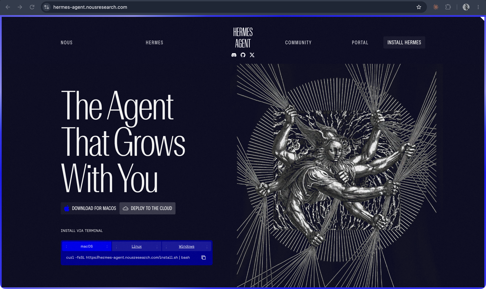

# Hermes Agent

**Nous Research's open-source, self-hosted agent, "the agent that grows with you": it keeps memory across sessions and writes its own reusable skills; released in early 2026.**

## In plain terms

Hermes Agent is a program you install (or deploy to a server) that runs an agent loop over a language model, and that you can reach from Telegram, Discord, Slack, WhatsApp, Signal, email, or the command line. It runs on a laptop, in Docker, over SSH, or on cloud sandboxes; the project says "a $5 VPS" is enough.

Its claim to be "self-improving" rests on two things, both ordinary files rather than changes to the model's weights. It keeps curated memory and can search its past sessions; and after a complex task it can write a skill, a reusable set of instructions, and revise it with use. Skills follow the shared agentskills.io format. A built-in command, `hermes claw migrate`, imports settings, memories, and skills from OpenClaw.

Hermes Agent is distinct from Nous Research's older Hermes language models: it is the agent program, not a model, and the code is MIT-licensed.

## Where it fits

**Agency and memory.** Hermes Agent arrived as OpenClaw's open-source neighbor and made one part of the agent explicit: the agent writing down what it learns, as memory and as skills, so the next session starts further along. It is the clearest example of "learning" in this story that happens in text files rather than in training.

## Try it

[Mini-claw](/mini-claw) builds a small agent with the same parts: a loop, tools, memory, and skills.

## See also

[OpenClaw](openclaw.md) · [Grok Bot](grok-bot.md) · [Agent](../interfaces-and-agents/agent.md) · [Agent loop](../interfaces-and-agents/agent-loop.md) · [Always-on agent](../interfaces-and-agents/always-on-agent.md) · [Skills](../interfaces-and-agents/skills.md) · [Memory](../interfaces-and-agents/memory.md) · [Harness](../interfaces-and-agents/harness.md)

## Sources

- Nous Research, [hermes-agent repository](https://github.com/NousResearch/hermes-agent), fetched 19 October 2026: the tagline, MIT license, memory and session search, autonomous skill creation, agentskills.io, the messaging platforms, the terminal backends and "$5 VPS," the OpenClaw migration command. Also confirmed in this repo's [fact-check ledger](../../history/fact-check.md), which also notes that Hermes Agent is distinct from the older Hermes model family.
- GitHub API record for the repository: earliest published release, Hermes Agent v0.2.0, on 12 March 2026 (the repository itself dates from July 2025).
- Launch month: secondary sources such as [DigitalOcean's overview](https://www.digitalocean.com/resources/articles/what-is-hermes-agent) give February 2026 (as recorded in the fact-check ledger; not reopened here); no dated announcement from Nous Research was found (verify).
- Screenshot `22-hermes-agent-homepage.png`, captured 19 October 2026 at hermes-agent.nousresearch.com.
