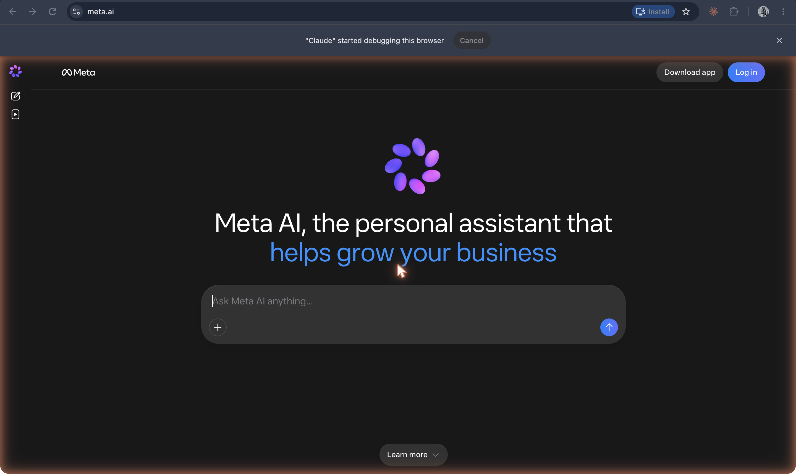

# Meta AI

**Meta's assistant inside WhatsApp, Messenger, and Instagram, introduced in beta on 27 September 2023 alongside a cast of AI characters played by celebrities, which Meta removed the following summer.**

## In plain terms

Meta announced two things together in September 2023. One was Meta AI, "an advanced conversational assistant" built on "a custom model that leverages technology from Llama 2," placed inside the messaging apps people already used, with web search through Bing and image generation. The other was a set of AIs "with personalities": Meta "partnered with cultural icons and influencers to play and embody some of these AIs," each with its own Instagram and Facebook profile. Kendall Jenner was Billie, a "No-BS, ride-or-die companion"; Snoop Dogg was the Dungeon Master; Tom Brady was Bru, a "wisecracking sports debater"; Paris Hilton was Amber, a "detective partner for solving whodunnits." Meta's reasoning: "interacting with them should feel like talking to familiar people."

The characters did not last. By 1 August 2024 their accounts were gone, and Meta confirmed the removal; the *New York Post*, citing *The Information*, reported that users had largely ignored them and some found them "weird and creepy." The assistant went the other way: in April 2025 Meta launched a standalone Meta AI app built with Llama 4 that can "remember certain things about you" and draw on what users have shared on Meta's platforms.

## Where it fits

**Persona.** Meta tried two persona strategies at once: one assistant everywhere, and many characters with famous faces. The famous faces failed and the single assistant stayed, now with memory. In 2026 Meta added [Muse](muse.md), an agent with its own computer.

## In the readings

Gilbert's line in Wilde's "The Critic as Artist" is a fair motto for the celebrity AIs, and also a question about them: "Man is least himself when he talks in his own person. Give him a mask, and he will tell you the truth" ([*Intentions*, "The Critic as Artist," part II](https://github.com/ll-26-27/eng-298ai-context/blob/24df8b8/_context/course-readings/course-readings-md/wilde-intentions.md#L575)). Meta's version reversed the terms: the mask was a famous face, and what spoke behind it was a language model.

## Try it

The [persona dial](/persona-dial) changes a name and an avatar while the engine stays fixed, which is what Meta's celebrity AIs did with famous faces.

## See also

[Muse](muse.md) · [Character.AI](character-ai.md) · [Persona](../persona-and-dialogue/persona.md) · [Character](../persona-and-dialogue/character.md) · [Companion](../persona-and-dialogue/companion.md) · [Memory](../interfaces-and-agents/memory.md) · ["The Critic as Artist"](../people-and-texts/the-critic-as-artist.md)

## Sources

- Meta, ["Introducing New AI Experiences Across Our Family of Apps and Devices"](https://about.fb.com/news/2023/09/introducing-ai-powered-assistants-characters-and-creative-tools/), 27 September 2023 (updated 10 January 2024): Meta AI in beta, the Llama 2-based model, Bing search, image generation, US only, the celebrity characters and their descriptions, the "familiar people" quotation.
- ["Meta ends failed celebrity AI chatbots after users ignored them"](https://nypost.com/2024/08/01/business/meta-ends-failed-celebrity-ai-chatbots-after-users-ignored-them/), *New York Post*, 1 August 2024, citing [*The Information*](https://www.theinformation.com/articles/meta-scraps-celebrity-ai-chatbots-that-fell-flat-with-users) (paywalled; not opened): the removal, Meta's confirmation, the "weird and creepy" reaction.
- Meta, ["Introducing the Meta AI App: A New Way to Access Your AI Assistant"](https://about.fb.com/news/2025/04/introducing-meta-ai-app-new-way-access-ai-assistant/), 29 April 2025: the standalone app built with Llama 4, memory and personalization.
- Screenshot `35-meta-ai-home-2026.png` (captured 19 October 2026, logged out): the service running at meta.ai; the basis for status "active".
