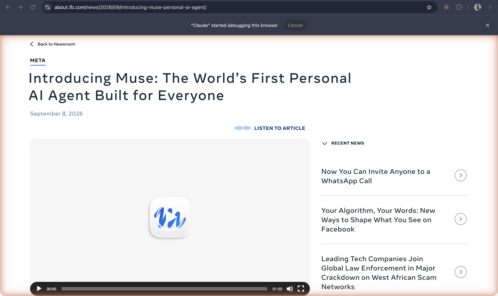

# Muse (Meta)

**Meta's personal AI agent, launched 8 September 2026: it runs on its own secure virtual machine with a browser, works in the Muse app or WhatsApp, remembers what matters to you, and can be given its own name, avatar, and style.**

## In plain terms

You tell Muse what needs doing, in the Muse app or in WhatsApp, and it acts: Meta's examples include sending an email, booking travel, selling a car, lowering a bill, and turning a saved recipe reel into a grocery list. It "can open a browser, fill out forms, and negotiate on their behalf," keeps working after you close the app, and comes back for approval "before it sends an email or makes a purchase."

It runs on what Meta calls Muse Secure VM, "a dedicated, virtual machine (VM) that houses both the agent and a person's data," with a separate Sentinel agent on the same machine that must approve anything Muse sends to the internet. Muse "remembers what matters to a person," and users can tell it to "forget" things. Meta's design essay says the team found it "odd talking to a corporate logo," so each user gets their own Muse: "Creating our own avatar, naming it, and giving it a unique style has become one of the core features people light up about most." At launch it was rolling out in the US on iOS, Android, and muse.ai.

## Where it fits

**Agency and persona.** Muse brings the always-on agent with its own computer to Meta's messaging scale, and it pairs agency with a persona the user designs: name, face, and manner. Where OpenClaw is a tool you configure, Muse is presented as someone you talk to "just like messaging another person."

## Try it

[Mini-claw](/mini-claw) builds a small agent by hand, to show the parts products like Muse package.

## See also

[Meta AI](meta-ai.md) · [Grok Bot](grok-bot.md) · [OpenAI's dots](openai-dots.md) · [OpenClaw](openclaw.md) · [Agent](../interfaces-and-agents/agent.md) · [Always-on agent](../interfaces-and-agents/always-on-agent.md) · [An agent's own computer](../interfaces-and-agents/agent-computer.md) · [Memory](../interfaces-and-agents/memory.md) · [Persona](../persona-and-dialogue/persona.md) · [Companion](../persona-and-dialogue/companion.md) · [Human in the loop](../interfaces-and-agents/human-in-the-loop.md) · [Permissions](../interfaces-and-agents/permissions.md)

## Sources

- Meta, ["Introducing Muse: The World's First Personal AI Agent Built for Everyone"](https://about.fb.com/news/2026/09/introducing-muse-personal-ai-agent/), 8 September 2026, updated 30 September 2026: the tasks, the browser and forms quotation, approval before sending or buying, Muse Secure VM and the Sentinel agent, memory and "forget," the Muse app and WhatsApp, the US rollout. "World's first" is Meta's headline, not a finding. Also confirmed in this repo's [fact-check ledger](../../history/fact-check.md).
- Meta, ["How We Designed Muse"](https://introducing.muse.ai/) (linked from the announcement, undated): the "corporate logo" remark and the avatar, name, and style quotation. Neither source mentions a file system or terminal for Muse (verify), and the claim that these choices cause users to bond with Muse is not sourced.
- Screenshot `24-meta-introducing-muse-sep2026.png`, captured 19 October 2026. The in-app interface was not captured.
