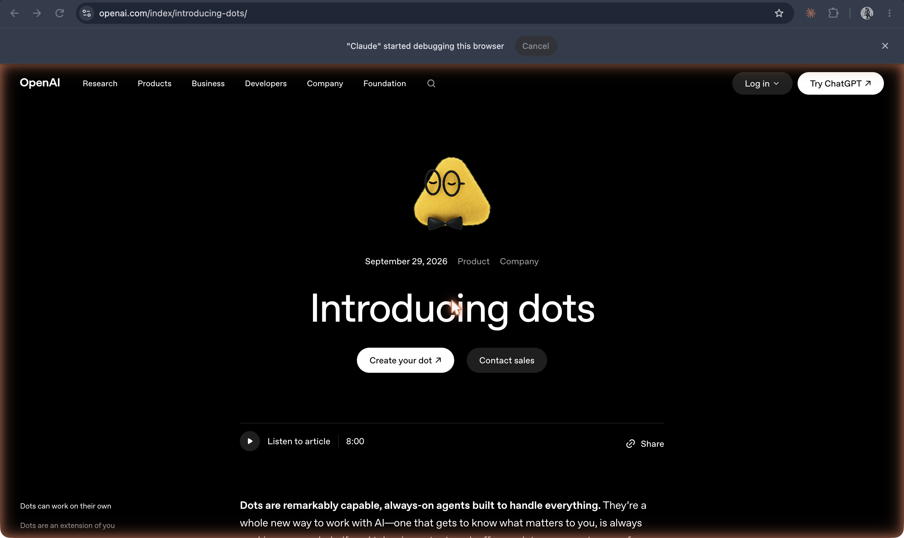

# dots (OpenAI)

**OpenAI's always-on agents, introduced 29 September 2026: each dot has its own cloud computer and browser, connects to your apps, works in the background, and can be named and messaged in ChatGPT, Slack, or Teams.**

## In plain terms

OpenAI's post calls dots "always-on agents built to handle everything." Each one runs on "their own cloud computer, their own browser, and the apps you've connected" (through plugins, "over 4,000 apps"), and you can open its computer to inspect the work or let it use your laptop. You start with one "primary dot," "give it a name, and make it your own," then message it, or call it, in ChatGPT, Slack, or Teams. It "learns your preferences, how you think, and what good looks like to you."

When you are not working with it, a dot does what OpenAI calls "proactive research," reading your connected apps with read-only tools to look for ways to help. Rules decide what it may do alone and what needs approval; some actions, such as changing a password, always stay with the user. OpenAI also previewed "specialist dots" with their own identities and credentials for jobs inside companies. The rollout began on 29 September 2026 for Pro and Business Premium users, with an Enterprise beta.

## Where it fits

**Agency and memory.** Dots are OpenAI's entry in the late-summer 2026 turn to hosted always-on agents, seven weeks after xAI's [Grok Bot](grok-bot.md) and three after Meta's [Muse](muse.md): the chatbot becomes a named worker with its own computer, standing access to your apps, and work it starts without being asked. The name has no connection to New Computer's companion app [Dot](dot.md) (2024–2025).

## Try it

[Mini-claw](/mini-claw) builds a small always-on agent by hand, to show the parts dots package.

## See also

[ChatGPT](chatgpt.md) · [Grok Bot](grok-bot.md) · [Muse](muse.md) · [Dot (New Computer)](dot.md) · [OpenClaw](openclaw.md) · [Agent](../interfaces-and-agents/agent.md) · [Always-on agent](../interfaces-and-agents/always-on-agent.md) · [An agent's own computer](../interfaces-and-agents/agent-computer.md) · [Computer use](../interfaces-and-agents/computer-use.md) · [Plugins](../interfaces-and-agents/plugins.md) · [Memory](../interfaces-and-agents/memory.md) · [Permissions](../interfaces-and-agents/permissions.md) · [Human in the loop](../interfaces-and-agents/human-in-the-loop.md) · [Prompt injection](../interfaces-and-agents/prompt-injection.md)

## Sources

- OpenAI, ["Introducing dots"](https://openai.com/index/introducing-dots/), 29 September 2026, fetched 19 October 2026: every quotation above, the cloud computer and browser, plugins and the 4,000 apps, naming the primary dot, ChatGPT, Slack, and Teams, proactive research, approvals and Custom Rules, specialist dots, the Pro, Business Premium, and Enterprise rollout. Also confirmed in this repo's [fact-check ledger](../../history/fact-check.md).
- Screenshot `23-openai-introducing-dots-sep2026.png`, captured 19 October 2026. The in-product interface was not captured (dots did not appear in the capturing account's ChatGPT workspace).
