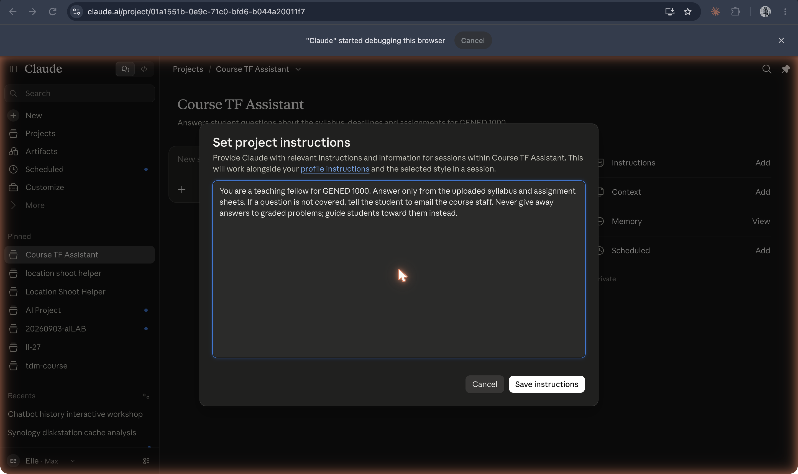

# Custom instructions

**Saved directions for how an assistant should respond.**

## In plain terms

Instructions describe desired behavior: for example, an invented Course TF Assistant rule might say, “Ask the student what they have tried before offering a solution.” They differ from the syllabus supplied as reference material.

ChatGPT provides saved custom instructions; a project can also have its own scoped directions. The layers experiment makes its assembled configuration visible.

## Try it

[the layers](/layers). Inspect the built configuration panels and assembled prompt; live replies require the configured Claude connection.

## See also

[Projects](projects.md) · [Knowledge (files)](knowledge-files.md) · [CLAUDE.md / AGENTS.md](instruction-files.md) · [System prompt](../persona-and-dialogue/system-prompt.md)

## Sources

- [ChatGPT custom instructions](https://help.openai.com/en/articles/8096356-chatgpt-custom-instructions)
- [Projects in ChatGPT](https://help.openai.com/en/articles/10169521-projects-in-chatgpt)
- [The layers experiment brief](../../experiments/layers.md)
- [Course screenshot collection](../../history/README.md); captions describe the archived image, not verified launch dates or future product plans.
