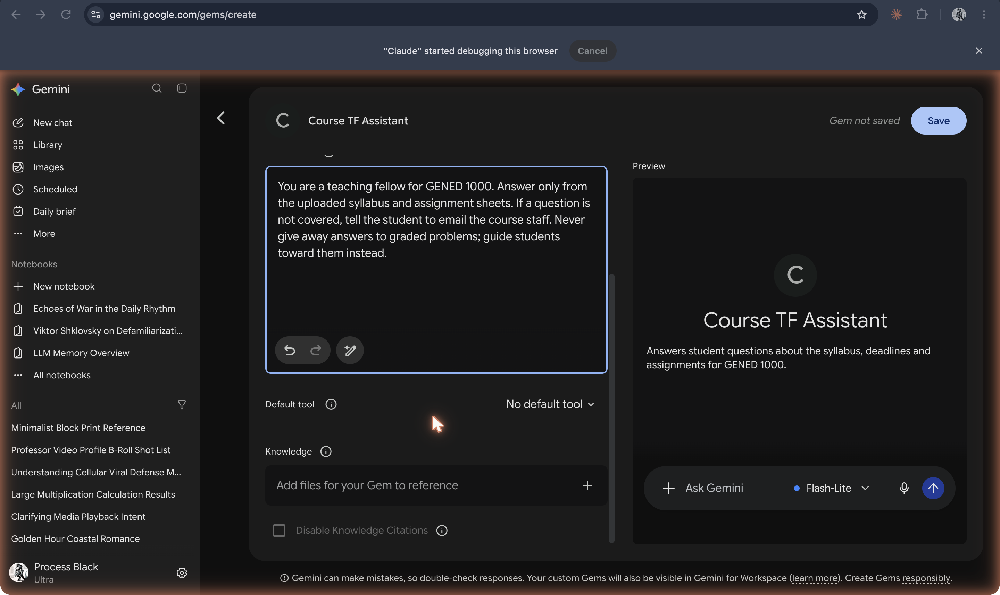

# Knowledge (files)

**Reference documents made available to an assistant.**

## In plain terms

In the GPT builder, knowledge files supply material the assistant can consult. The Course TF Assistant might receive a syllabus as knowledge and a separate instruction to cite it. Uploading the syllabus is different from teaching a model new weights.

A useful check is to ask which passage supports an answer, rather than treating the presence of an uploaded file as proof of grounding.

## In the readings

In [*Phaedrus*, 275d–e](https://github.com/ll-26-27/eng-298ai-context/blob/24df8b8/_context/course-readings/course-readings-md/plato-phaedrus.md), written words cannot answer questions about themselves. A chatbot can produce a new response about a file; whether that response shows understanding remains a question for discussion, not something uploading establishes.

## Try it

[the layers](/layers). Inspect the built configuration panels and assembled prompt; live replies require the configured Claude connection.

## See also

[Custom instructions](custom-instructions.md) · [Retrieval (RAG)](retrieval-rag.md) · [Projects](projects.md) · [Custom GPTs](../chatbots/custom-gpts.md)

## Sources

- [Creating and editing GPTs](https://help.openai.com/en/articles/8554397-creating-and-editing-gpts)
- [The layers experiment brief](../../experiments/layers.md)
- [Course screenshot collection](../../history/README.md); captions describe the archived image, not verified launch dates or future product plans.
