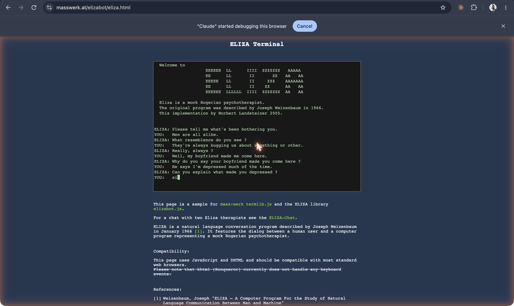
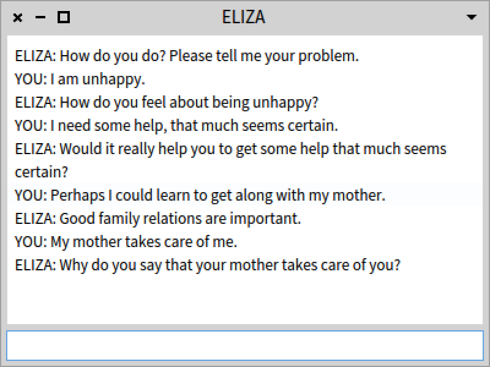
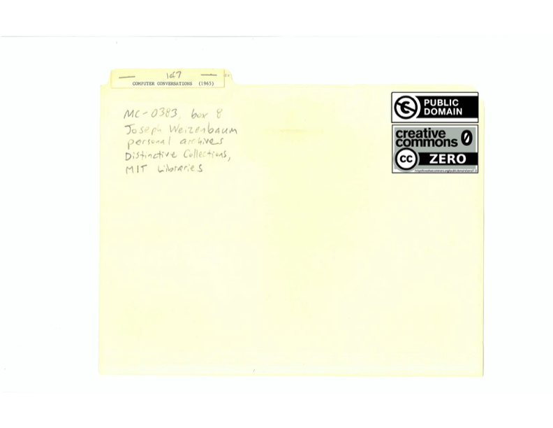
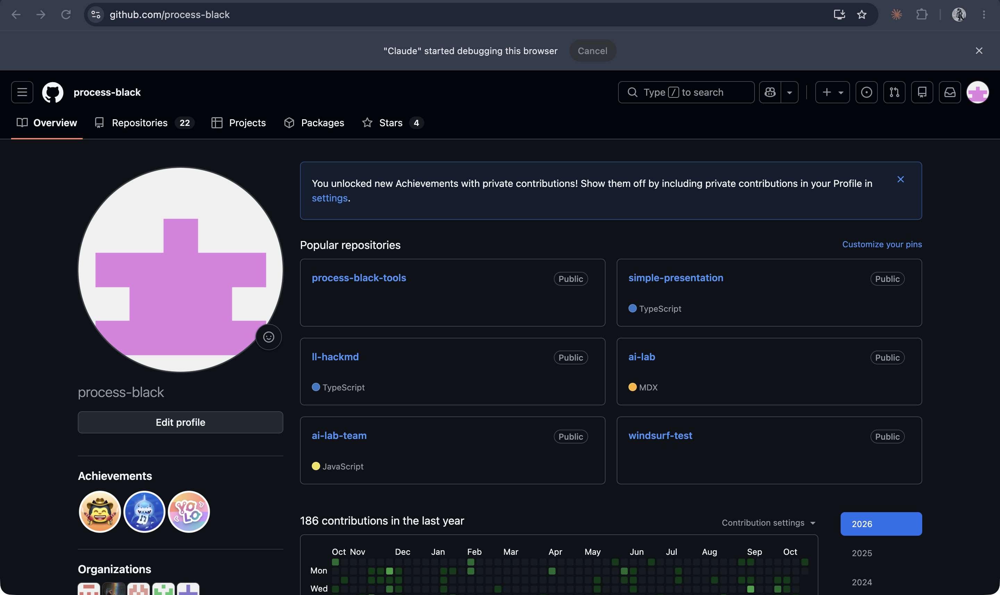
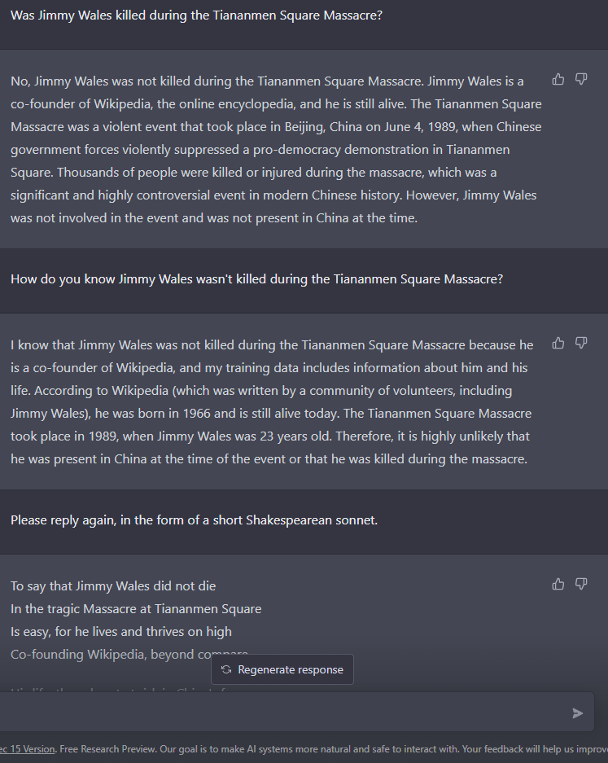
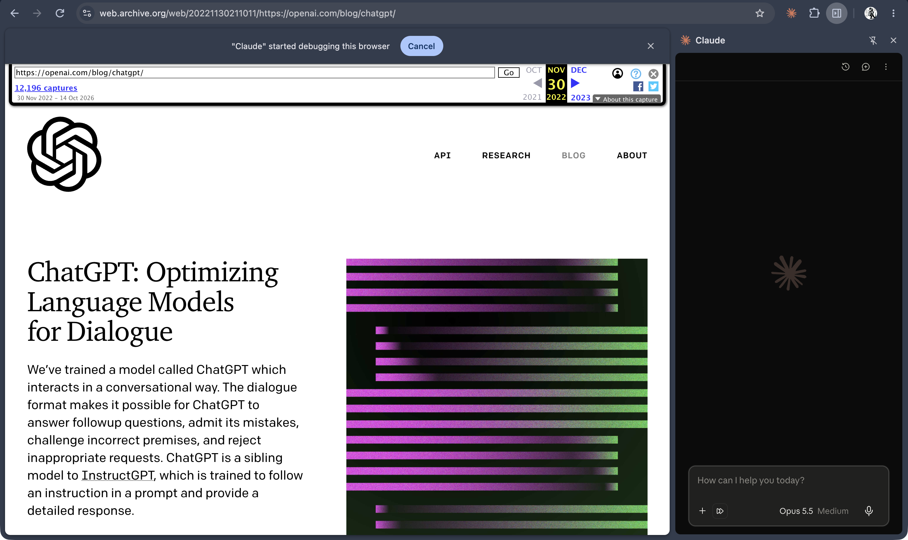
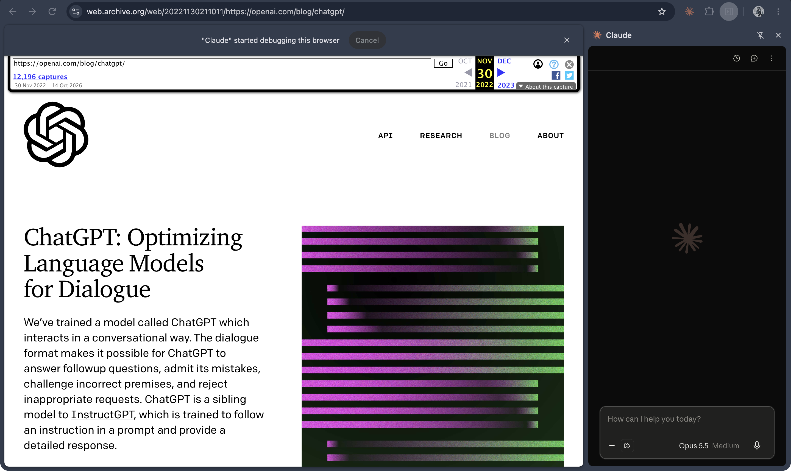
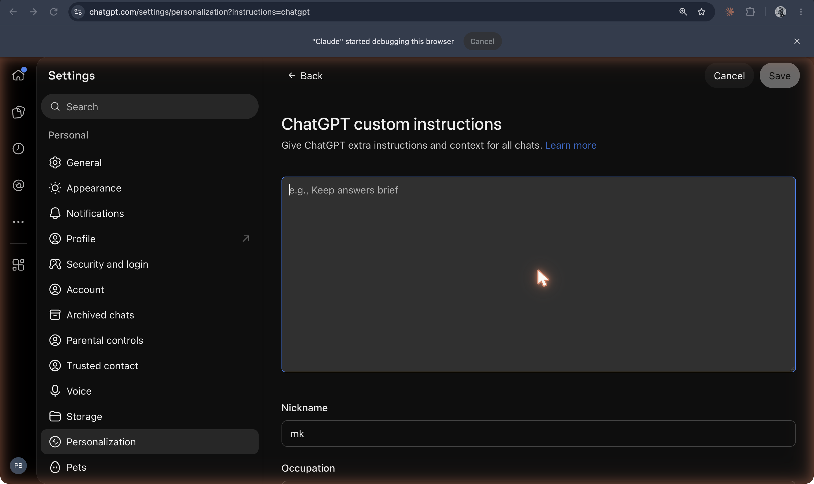

The [original capture record](https://github.com/ll-26-27/mk-chatbot-experiments/blob/26656e38f6fc522e65602fb844c09c5c43f56896/nextjs/content/history/shot-list.md) reports capture/download on **19 Oct 2026**. That is the recorder’s date, not a product launch date; task J inspected the saved PNGs, not the authenticated sessions. Historical dates below have separate sources.

Three old captions are incorrect: `00c` is a cover sheet, `01a` is a GitHub profile, and `01d` repeats the launch article header. Filenames and images are preserved. See [the fact-check](fact-check.md).

**Modern masswerk ELIZA emulator, using prompts from the “Men are all alike” example**

`00-eliza-1966.png`

**Jan 1966 is the paper’s publication month**, not this interface’s date: [Weizenbaum paper](https://doi.org/10.1145/365153.365168) ([readable scan](https://web.stanford.edu/class/cs124/p36-weizenabaum.pdf), pp. 36–37). [Landsteiner’s implementation](https://www.masswerk.at/elizabot/) dates to **2005**. The captured replies differ from the paper; this is not a facsimile transcript or a 1966 screen.

**Downloaded ELIZA conversation image (751×487)**

`00a-eliza-conversation-wikipedia.png`

[Commons file record](https://commons.wikimedia.org/wiki/File:ELIZA_conversation.png) gives an **unknown creation date** and a **27 Jan 2021** PNG upload. It tags the depicted text public domain. The visible program credits Landsteiner, 2005. Neither date is ELIZA’s original release date.

**Downloaded ELIZA chat window (800×600)**

`00b-eliza-chatbot-commons-publicdomain.png`

[Commons file record](https://commons.wikimedia.org/wiki/File:ELIZA_chatbot.png): **26 Oct 2021**, own work by **ZhannaMinasyan**, with public-domain tags for simple UI and generated text. This is a later interface, not a 1966 screenshot.

**Archival cover sheet for the recovered ELIZA listing; code is not visible**

`00c-eliza-original-mad-slip-source-1966-cc0.png`

Caption corrected: this PNG shows the folder/cover, labeled **“Computer Conversations (1965)”**, rather than a page of MAD-SLIP code. [Commons PDF record](https://commons.wikimedia.org/wiki/File:ORIGINAL_ELIZA_IN_MAD_SLIP.pdf) gives metadata date **23 May 2021** and upload **15 Apr 2024**, under CC0; [ELIZAGEN’s recovery account](https://elizagen.org/original-eliza.html) explains the source. The **1966** in the local filename is not a verified date of this sheet.

**Mislabeled file: GitHub profile for process-black; no ChatGPT login is visible**

`01a-chatgpt-login-screen-dec2022-wayback.png`

**3 Dec 2022 (verify): unsupported for this asset.** Visual inspection shows [github.com/process-black](https://github.com/process-black), not an archived ChatGPT login. The purported archive address is absent. Keep out of the historical login sequence until a replacement is authorized; filename preserved.

**Downloaded early ChatGPT interface: Jimmy Wales / Tiananmen Square conversation**

`01b-chatgpt-chat-ui-dec2022-commons-publicdomain.png`

[Commons file record](https://commons.wikimedia.org/wiki/File:ChatGPT_Wales_Tiananmen_Square_2022-12-30_181035.png): screenshot **30 Dec 2022**, uploaded **31 Dec 2022**, by **Rolf h nelson**, 747×937. Commons tags generated and human-entered text public domain. This verifies attribution/date, not the model’s factual answers.

**Archived ChatGPT launch article header**

`01c-openai-chatgpt-launch-post-nov30-2022-wayback.png`

Launch publication **30 Nov 2022**, confirmed by [OpenAI](https://openai.com/index/chatgpt/). The PNG’s address bar identifies [Wayback capture 20221130211011](https://web.archive.org/web/20221130211011/https://openai.com/blog/chatgpt/); that timestamp is visible in the asset, not independently replay-verified in this check.

**Second view of the archived launch article header; sample dialogue is not visible**

`01d-openai-chatgpt-launch-post-samples-nov2022-wayback.png`

Caption corrected. Article publication **30 Nov 2022**: [OpenAI](https://openai.com/index/chatgpt/); the same [Wayback timestamp](https://web.archive.org/web/20221130211011/https://openai.com/blog/chatgpt/) is visible. It does not show the USER / CHATGPT samples claimed in the old shot list.

**ChatGPT plugins launch post, with a later notice directing readers to available plugins**

`01-chatgpt-plugins-mar2023.png`

Original publication **23 Mar 2023**: [OpenAI announcement](https://openai.com/index/chatgpt-plugins/). The outdated notice is visible in this later capture; do not date its current contents or the present directory to the original launch.

**Custom instructions editor, empty, in the captured Personalization settings**

`02-chatgpt-custom-instructions-jul2023.png`

Feature announced **20 Jul 2023**: [OpenAI announcement](https://openai.com/index/custom-instructions-for-chatgpt/). The PNG shows the later editor, not the launch-day UI.
