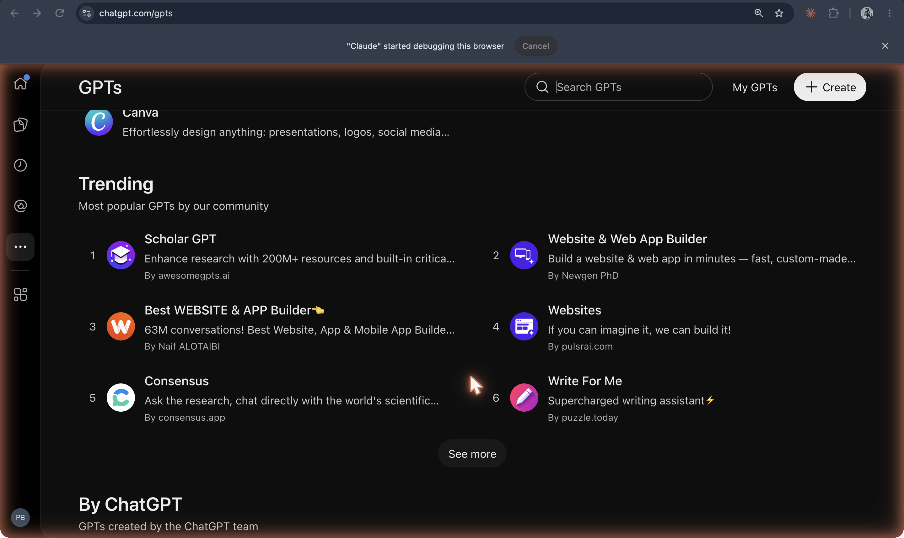
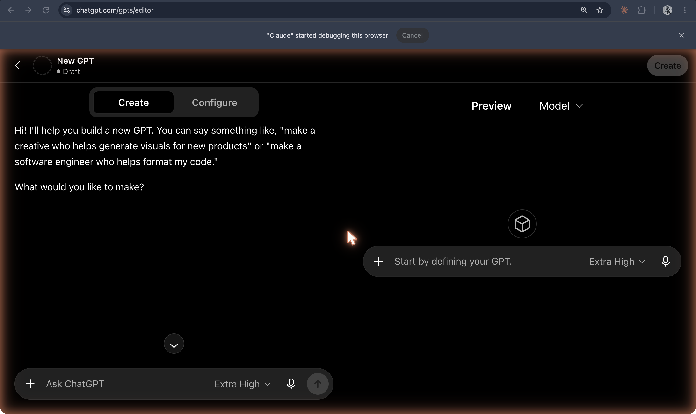
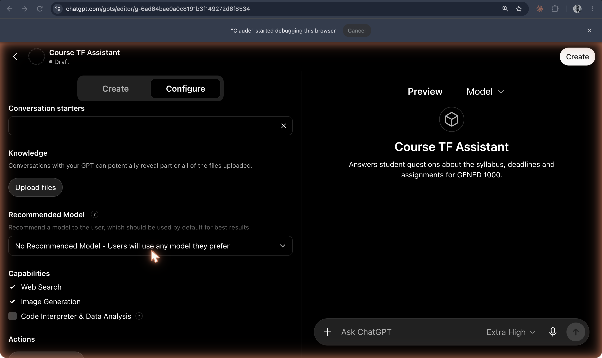
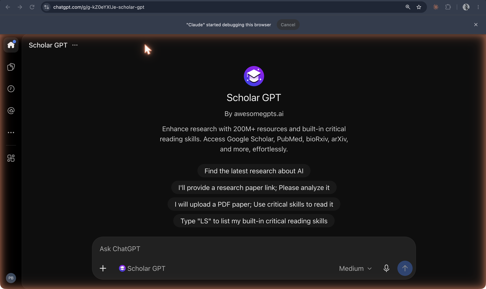
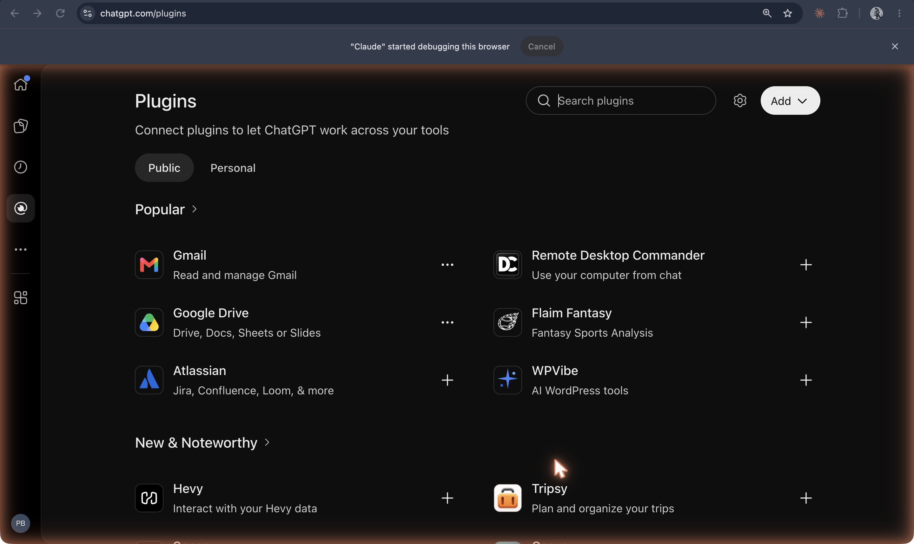

The [original capture record](https://github.com/ll-26-27/mk-chatbot-experiments/blob/26656e38f6fc522e65602fb844c09c5c43f56896/nextjs/content/history/shot-list.md) reports capture/download on **19 Oct 2026**. That is the recorder’s date, not a product launch date; task J inspected the saved PNGs, not the authenticated sessions. Historical dates below have separate sources.

**GPT Store Featured gallery with a December 11 retirement banner**

`03-gpt-store-gallery-with-retirement-banner.png`

GPTs announced **6 Nov 2023**: [OpenAI](https://openai.com/index/introducing-gpts/). Store rollout **10 Jan 2024**: [OpenAI](https://openai.com/index/introducing-the-gpt-store/). Planned standard retirement **11 Dec 2026**: [retirement FAQ](https://help.openai.com/en/articles/20001519-custom-gpt-retirement-and-migration-faq); approved Enterprise deferrals use **11 Feb 2027**. Migration and access vary by account; the banner is not evidence that every GPT migrates automatically.

**Trending GPTs list**

`04-gpt-store-trending.png`

Observed list in this capture; ranking is not a historical or stable measure of popularity. [Store announcement](https://openai.com/index/introducing-the-gpt-store/) describes the gallery and community leaderboard.

**GPT builder Create tab**

`05-gpt-builder-create-tab.png`

Observed conversational builder. [GPT announcement](https://openai.com/index/introducing-gpts/) documents building by conversation; this image does not establish current eligibility for other accounts.

**GPT Configure tab with a draft “Course TF Assistant”**

`06-gpt-builder-configure-tab.png`

Observed name, description and instructions for the recorder’s example. The Draft label is visible; this is not evidence of a published GPT. [Feature source](https://openai.com/index/introducing-gpts/).

**GPT Configure tab: Knowledge, Recommended Model, Capabilities and Actions**

`07-gpt-builder-knowledge-capabilities.png`

Observed settings. Knowledge upload is empty in the PNG; a capability being listed does not mean it was used. [Feature source](https://openai.com/index/introducing-gpts/).

**Scholar GPT landing page with conversation starters**

`08-gpt-in-use-scholar-gpt.png`

Observed landing page, not a completed conversation or performance test. [Captured GPT address](https://chatgpt.com/g/g-kZ0eYXlJe-scholar-gpt). Creator claims in its description are not validated by this screenshot.

**ChatGPT Plugins directory in the captured account**

`09-chatgpt-plugins-directory-2026.png`

This is the later [Plugins directory](https://chatgpt.com/plugins), distinct from the original plugin beta. [GPT migration FAQ](https://help.openai.com/en/articles/20001519-custom-gpt-retirement-and-migration-faq) confirms the replacement path, with creator action/testing and access constraints. **2026** is the capture year; no directory launch date is established here.
