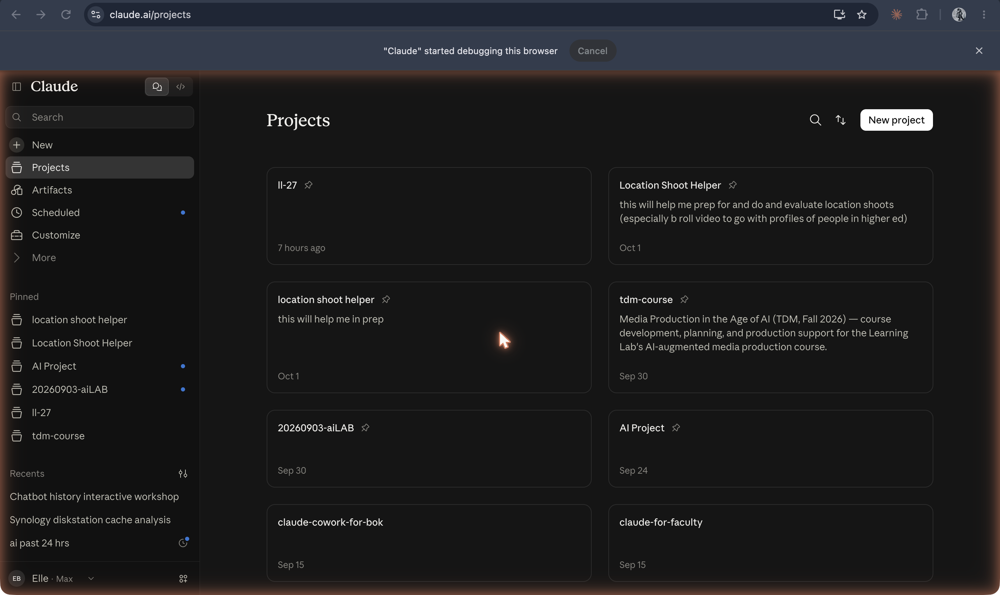
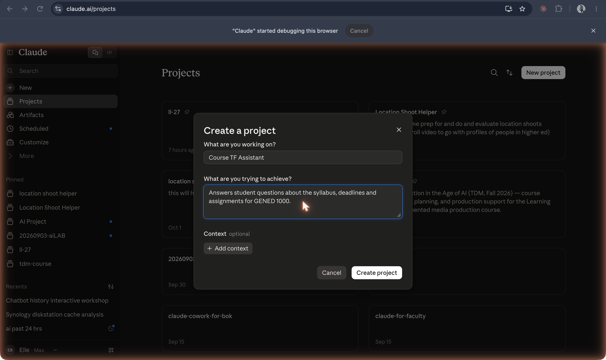
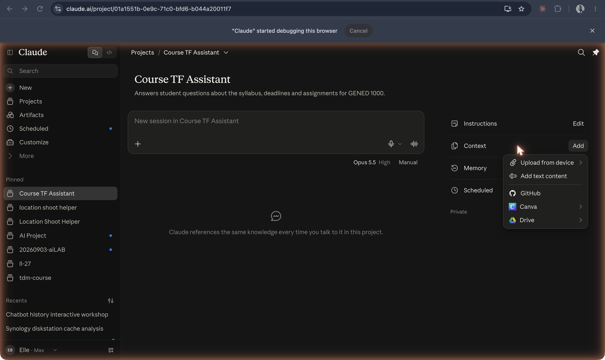

The [original capture record](https://github.com/ll-26-27/mk-chatbot-experiments/blob/26656e38f6fc522e65602fb844c09c5c43f56896/nextjs/content/history/shot-list.md) reports capture/download on **19 Oct 2026**. That is the recorder’s date, not a product launch date; task J inspected the saved PNGs, not the authenticated sessions. Historical dates below have separate sources.

**Claude Projects list in the captured account**

`12-claude-projects-list.png`

Projects announced **25 Jun 2024**: [Anthropic](https://www.anthropic.com/news/projects). The saved list is a later account view, not the launch interface.

**Create project dialog filled in as “Course TF Assistant”**

`13-claude-create-project-dialog.png`

Observed name and description. [Anthropic Projects announcement](https://www.anthropic.com/news/projects) documents projects; the example is the recorder’s setup, not a vendor template.

**Set project instructions dialog**

`14-claude-project-instructions-dialog.png`

Observed instruction text. [Anthropic](https://www.anthropic.com/news/projects) confirms project-level custom instructions; the PNG does not prove they were saved.

**Project Context menu: upload, text content, GitHub, Canva and Drive**

`15-claude-project-knowledge-add-context-menu.png`

These choices are visible in this account. [Anthropic Projects announcement](https://www.anthropic.com/news/projects) establishes project knowledge in general, not every integration shown in this later menu. No successful connection/upload is demonstrated.

**Project chat declining a graded answer and referring a missing deadline to course staff**

`16-claude-chat-inside-project.png`

Observed single response. It says there are no uploaded syllabus/assignment documents. This supports the narrow behavioral caption, not general reliability or verified course information. [Feature source](https://www.anthropic.com/news/projects).
