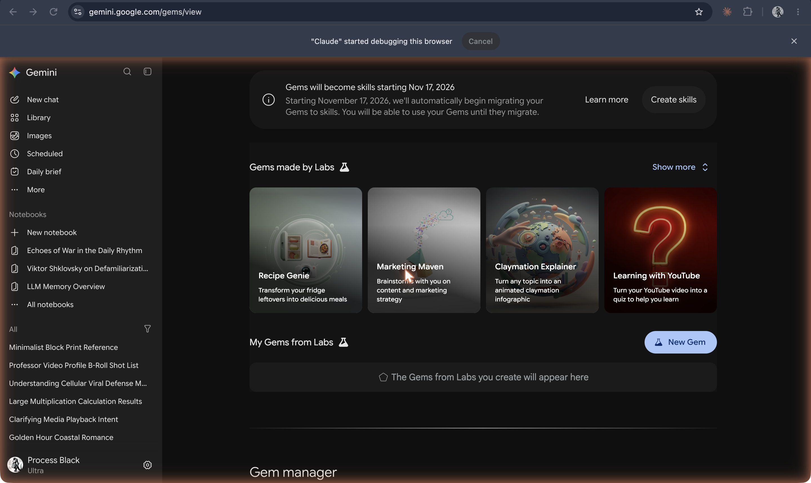
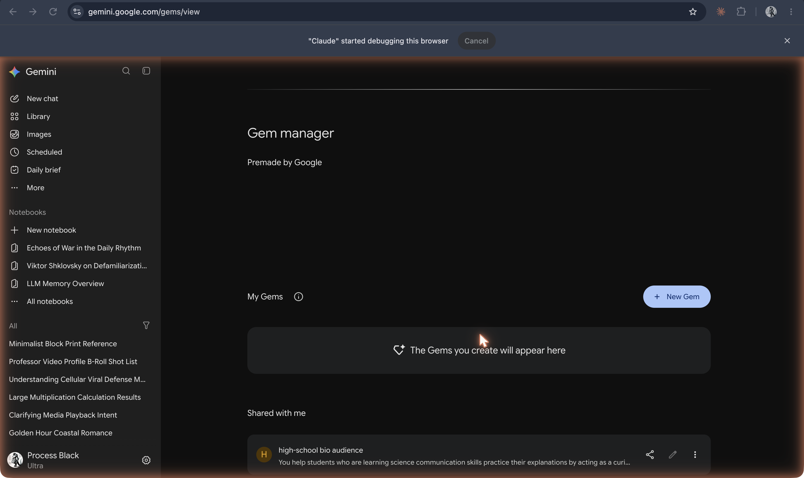

The [original capture record](https://github.com/ll-26-27/mk-chatbot-experiments/blob/26656e38f6fc522e65602fb844c09c5c43f56896/nextjs/content/history/shot-list.md) reports capture/download on **19 Oct 2026**. That is the recorder’s date, not a product launch date; task J inspected the saved PNGs, not the authenticated sessions. Historical dates below have separate sources.

**Gems gallery and banner saying migration to skills starts November 17, 2026**

`17-gemini-gems-gallery-with-skills-banner.png`

Gems previewed **14 May 2024**: [Google I/O post](https://blog.google/products/gemini/google-gemini-update-may-2024/); rollout announced **28 Aug 2024**: [Google Workspace](https://workspaceupdates.googleblog.com/2024/08/customize-gemini-with-gems.html). **17 Nov 2026 is not a universal sunset**: [Workspace transition schedule](https://knowledge.workspace.google.com/admin/generative-ai/gemini-app/about-the-transition-to-skills) says Gems move to Settings and remain usable; business/enterprise removal no sooner than **1 Mar 2027**, education **1 Jun 2027**. [Personal-account guidance](https://support.google.com/gemini/answer/18560919) instead specifies November 2026. Read the account-specific schedule.

**Gem manager with the Premade by Google section empty in this capture**

`18-gemini-gem-manager.png`

Observed rendering state. It does not prove Google had no premade Gems; [Google’s rollout post](https://workspaceupdates.googleblog.com/2024/08/customize-gemini-with-gems.html) describes premade examples.

**Unsaved Gem editor for “Course TF Assistant”, with preview panel**

`19-gemini-gem-editor.png`

Observed name, instructions and preview. “Gem not saved” is visible. [Google’s guidance](https://blog.google/products-and-platforms/products/gemini/google-gems-tips/) explains instruction-based customization.

**Unsaved Gem editor: Default tool and Knowledge**

`20-gemini-gem-editor-knowledge.png`

Observed settings, with “No default tool” selected and no knowledge uploaded. [Google transition guidance](https://support.google.com/gemini/answer/18560919) confirms that Gems can contain knowledge files; this PNG does not show retrieval working.
