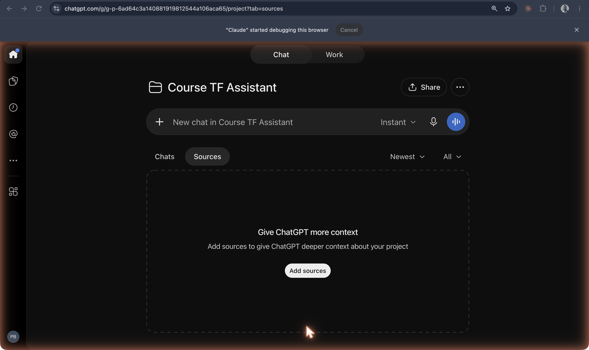

The [original capture record](https://github.com/ll-26-27/mk-chatbot-experiments/blob/26656e38f6fc522e65602fb844c09c5c43f56896/nextjs/content/history/shot-list.md) reports capture/download on **19 Oct 2026**. That is the recorder’s date, not a product launch date; task J inspected the saved PNGs, not the authenticated sessions. Historical dates below have separate sources.

**ChatGPT project settings: instructions, Memory and Space access**

`10-chatgpt-project-settings-instructions.png`

Projects announced **13 Dec 2024**: [OpenAI release notes, “Projects in ChatGPT”](https://help.openai.com/en/articles/6825453-chatgpt-release-notes). Later controls visible in the capture are not thereby dated to the original release.

**Project Sources tab, empty, inviting the user to add context**

`11-chatgpt-project-page-sources.png`

Observed later project UI. [Original release notes](https://help.openai.com/en/articles/6825453-chatgpt-release-notes) establish files and project instructions; this screenshot shows no uploaded sources.
