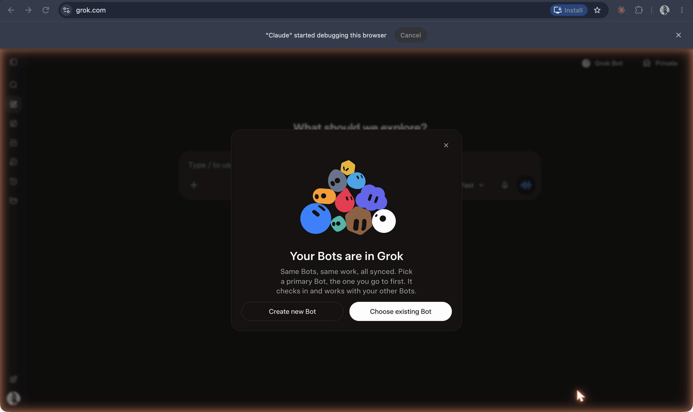

The [original capture record](https://github.com/ll-26-27/mk-chatbot-experiments/blob/26656e38f6fc522e65602fb844c09c5c43f56896/nextjs/content/history/shot-list.md) reports capture/download on **19 Oct 2026**. That is the recorder’s date, not a product launch date; task J inspected the saved PNGs, not the authenticated sessions. Historical dates below have separate sources.

The saved set has announcement pages for Muse and dots, not their in-product interfaces. The capture record says dots was absent from the recorder’s sidebar; that is an account-specific observation. Muse is available on the web as well as in its apps/WhatsApp; “needs its own app” was too restrictive.

**OpenClaw homepage advertising an open-source agent that runs on your machine**

`21-openclaw-homepage.png`

Founder dates the project’s beginnings to **Nov 2025**, and announces the name **OpenClaw on 29 Jan 2026**: [Introducing OpenClaw](https://openclaw.ai/blog/introducing-openclaw). The naming account includes Clawd and Moltbot. Homepage capabilities are maker claims, not tested outcomes.

**Nous Research Hermes Agent homepage**

`22-hermes-agent-homepage.png`

Release **25 Feb 2026**: [Nous Research release list](https://nousresearch.com/releases). [Official repository](https://github.com/NousResearch/hermes-agent) documents memory, skill creation, tools and messaging surfaces. “Self-improving” here does not mean it retrains its weights.

**Grok Bot announcement: always-on agents with their own computer**

`25-xai-introducing-grok-bot-aug2026.png`

Announcement **11 Aug 2026**: [xAI / SpaceXAI](https://x.ai/news/introducing-grok-bot). [Official launch video](https://www.youtube.com/watch?v=F1_0Lkp16Rc) confirms beta launch and the date. Cloud computer and persistence are announced features; not tested in this capture.

**grok.com popup: “Your Bots are in Grok”**

`26-grok-your-bots-are-in-grok-popup.png`

Observed popup offering creation or selection of a Bot. [Grok Bot announcement](https://x.ai/news/introducing-grok-bot) supports the product description, but no date for this particular integration/popup is established. It is not the public @grok reply account.

**Meta Muse personal-agent launch announcement**

`24-meta-introducing-muse-sep2026.png`

Publication **8 Sep 2026**, updated **30 Sep 2026**: [Meta Newsroom](https://about.fb.com/news/2026/09/introducing-muse-personal-ai-agent/). [Meta’s technical post](https://research.meta.ai/blog/security-and-safety-for-ai-agents-our-approach-with-muse) confirms the cloud VM/browser architecture. “World’s first” is the maker’s headline, not a verified priority claim.

**OpenAI dots launch announcement**

`23-openai-introducing-dots-sep2026.png`

Publication **29 Sep 2026**: [OpenAI](https://openai.com/index/introducing-dots/). Describes persistent agents with a cloud computer and connected apps, rolling out to eligible plans/markets. OpenAI dots is distinct from New Computer’s discontinued Dot.
