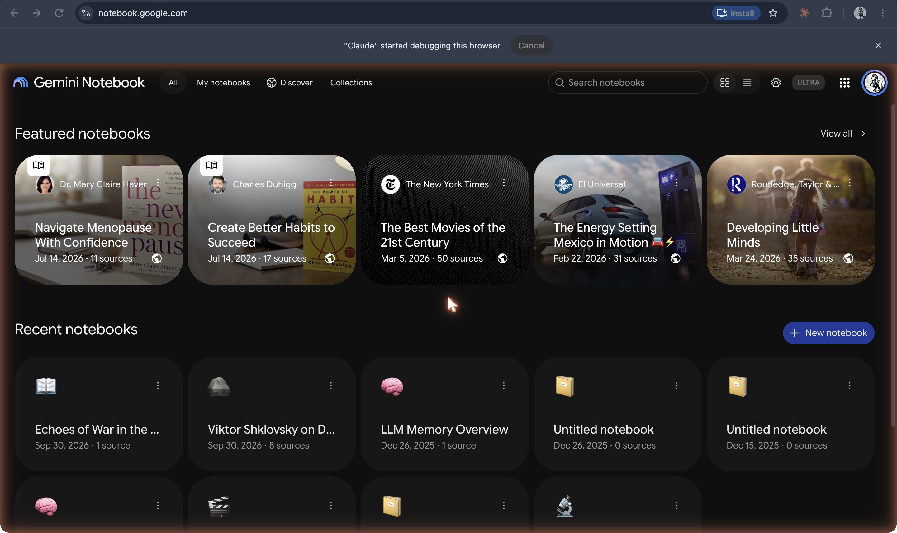
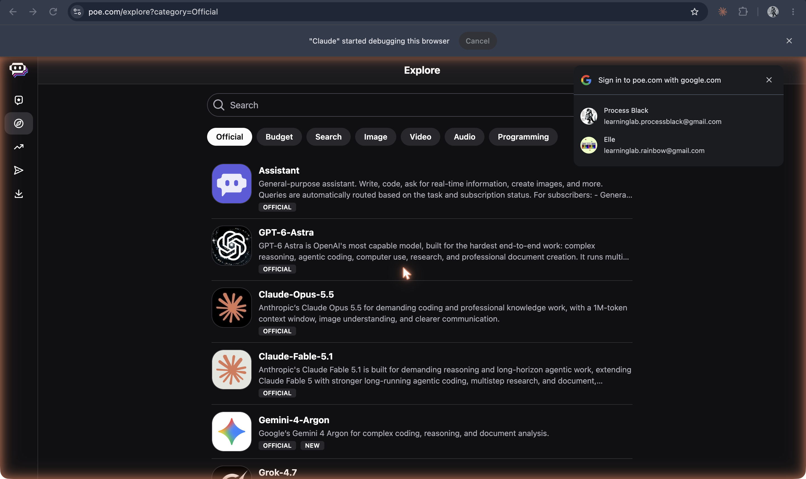
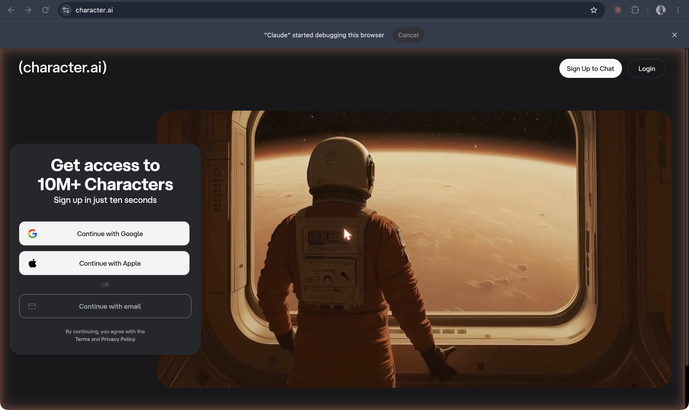

The [original capture record](https://github.com/ll-26-27/mk-chatbot-experiments/blob/26656e38f6fc522e65602fb844c09c5c43f56896/nextjs/content/history/shot-list.md) reports capture/download on **19 Oct 2026**. That is the recorder’s date, not a product launch date; task J inspected the saved PNGs, not the authenticated sessions. Historical dates below have separate sources.

Copilot Studio is absent from this set. The recorder reported a work-account sign-in barrier; task J did not test current access requirements.

**Gemini Notebook home at notebook.google.com, formerly NotebookLM**

`40-gemini-notebook-formerly-notebooklm-2026.png`

Rename announced **16 Jul 2026**: [Google, “NotebookLM is now Gemini Notebook”](https://blog.google/innovation-and-ai/products/gemini-notebook/notebooklm-gemini-notebook/). The saved URL bar says [notebook.google.com](https://notebook.google.com/); [public product site](https://notebook.google/) also confirms the name. This is the standalone product, not just notebooks within Gemini chat.

**Poe Explore with the Official filter selected**

`41-poe-explore-bots-2026.png`

Observed [Poe Explore](https://poe.com/explore?category=Official); a sign-in chooser overlays part of the view. “Official” is the platform filter, not evidence that every underlying model description was independently audited.

**Character.AI landing page with sign-up/login controls**

`42-character-ai-landing-2026.png`

Observed [character.ai](https://character.ai/) landing view. No character conversation was captured; the screenshot’s marketing count is not independently verified here.
